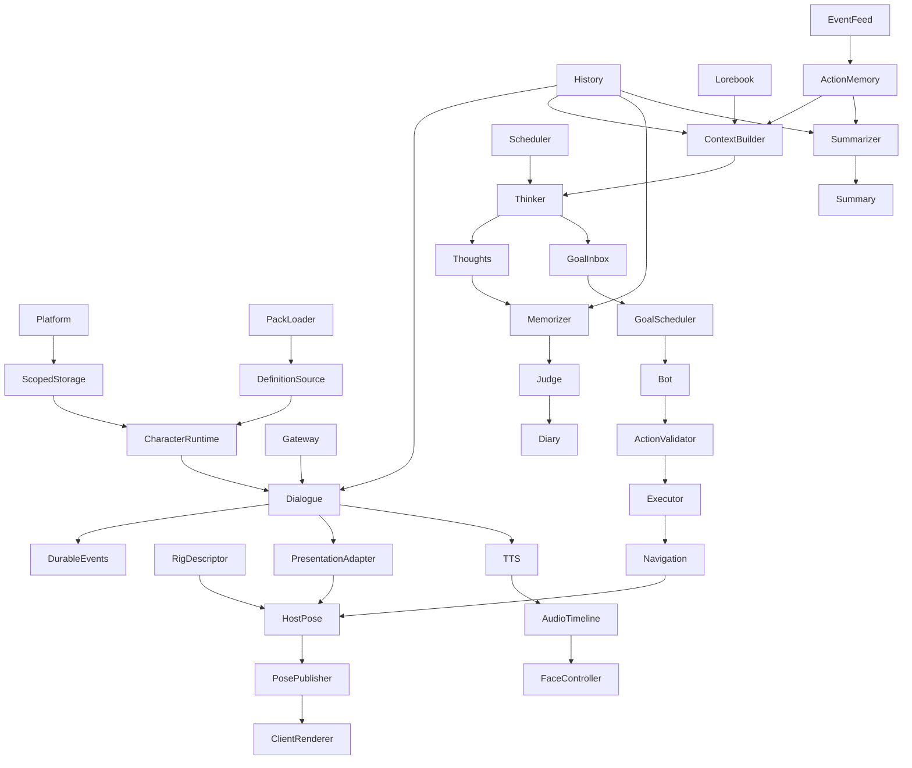

# AGNOR Implementation Blueprint
## Полная спецификация устройства, взаимодействия и отказоустойчивости

- **Статус:** Living technical specification; проектирование, не реализованный код.
- **Версия:** 0.2 (аудит зависимостей 2026-11-05)
- **Платформа:** Minecraft 1.21.1, Fabric, Java 21.
- **Связанные документы:** ARCHITECTURE.md, ROADMAP.md, DECISIONS.md, ADR-0001…ADR-0009.
- **Назначение:** определить внутреннее устройство подсистем, входы/выходы, владение данными, вызовы, жизненный цикл, отказные сценарии и критерии проверки до начала реализации.

> Документ описывает целевое устройство, а не существующий код. Open означает реальный незакрытый вопрос. Нельзя выдавать предположение за принятое решение или реализацию.

---

## 0. Метод и критерии полноты

Это не построчный псевдокод и не список имён переменных. Спецификация описывает исполняемую логику на уровне компонентов и контрактов.

Для каждой функции обязательны:
1. Назначение и границы ответственности: что делает и что ей запрещено.
2. Владелец: server, client или shared; кто создаёт и останавливает.
3. Триггеры: событие, расписание, пользовательская команда или внутренний вызов.
4. Входы: точные источники, schema/version, scope, доверие, свежесть и лимиты.
5. Предусловия: права, состояние мира, доступность зависимостей.
6. Алгоритм: этапы, ветвления, приоритеты, отмена и точки фиксации.
7. Выходы: результат, события и побочные эффекты.
8. Зависимости: интерфейсы и downstream consumers; запрещённые циклы.
9. Ошибки: классификация, retry, fallback, recovery.
10. Конкурентность: очередь, deduplication key, serialization и stale-result policy.
11. Persistence: что и когда сохраняется, транзакции и миграции.
12. Наблюдаемость: correlation ID, метрики и безопасные логи.
13. Проверки: happy path, негативные, конкурентные, restart, multiplayer и end-to-end.

Статусы: Agreed, Designed, Open, Validated, Implemented, Verified. Последние два применяются только после реального изменения кода и проверок. Числовые лимиты, тайм-ауты, очереди, tick budgets и retention задаются конфигурацией и измеряются; до профилирования это параметры, не выдуманные константы.

### 0.4 Назначение и порядок использования

Blueprint — спецификация целевой реализации, не второй roadmap. Последовательность, задачи и критерии приёмки находятся только в [ROADMAP](ROADMAP.md). Фактическая готовность — в журнале и [PROJECT_MAP](PROJECT_MAP.md). Прежняя фазовая часть сохранена [в архиве](archive/BLUEPRINT_PHASE_PLAN_2026-11-04.md); её design checklists исторические, а не обязательный предварительный gate для всего проекта. Разделы 1–29 ниже сохраняют подробные алгоритмы.

Перед задачей уточняются только затронутые контракты и риск, мешающий текущему решению. Не требуется полный дизайн ещё не используемых consumers. Числовые бюджеты определяются измерением в назначенной фазе; отсутствие будущего компонента обозначается NOT_YET_ENABLED, а не успешным пустым результатом.

### 0.5 Граф реализации и runtime-циклы

Граф показывает основные направления данных, не синхронный порядок вызовов. История имеет writer Dialogue и обратный read edge в следующий запрос. Diary/Summary возвращаются в следующий ContextBuilder snapshot; исход Executor возвращается в Observer/ActionMemory; Thoughts вызывает Memorizer. Эти runtime-циклы не являются build-зависимостями. Модули связываются интерфейсами, snapshots и durable records, не взаимными прямыми вызовами. Производитель может работать при NOT_YET_ENABLED будущего reader; после активации reader его текущие записи доступны независимо от будущих источников. Состояние AVAILABLE_EMPTY допустимо лишь у действительно включённого источника.

Топологический порядок реализации: platform → scoped storage/runtime → dialogue/history/gateway → rig/host pose/client presentation → packs → Lorebook/context → event feed/action memory → scheduler/Thinker/Thoughts → Memorizer/Judge/Diary → Summarizer/Summary → Goal/Action/Navigation/Bot → voice → release/addons. Gateway и History реализуются внутри диалогового среза; их входы не зависят от 3D. Доступная память постепенно подключается к одному ContextBuilder. Голос технически может подключаться сразу после dialogue/face; последовательность работ выбирает Roadmap.

### 0.6 Минимальные совместные вертикальные срезы

| Срез | Минимум участников | Независимая проверка | Позднейшая интеграция |
|---|---|---|---|
| Сохраняемая NPC | Registry, Runtime, scoped Storage, operation handler, placeholder | create/restart/delete, два игрока и мира | Renderer, память |
| Диалог | Gateway, History, ContextBuilder с текущими sources, UI | реальный ответ, provider failure, приватность/restart | Motion и gnomes |
| Видимое движение | RigDescriptor, host solver, snapshot, renderer | fixture pose и реальные NPC UUID без LLM | semantic dialogue/Thinker/action intents |
| Мысли | Scheduler, разрешённый context, Thinker, Thoughts writer | observed event → stored structured thought → affect | новый Diary/Summary source подключается позже |
| Воспоминание | History/Thoughts, Memorizer, candidate queue, Judge, Diary | candidate → dedupe/judgement → durable fact → context | полный цикл четырёх cognitive workers |
| Сводка | History, event feed, watermark, Summarizer, Summary | десять committed records → summary; restart | следующий Thinker читает summary |
| Действие | запрос цели, validator/executor, outcome; navigation для walk | разрешённая ручная цель → world effect → outcome | Bot/Thinker вместо ручного инициатора |
| Голос | TTS, playback clock, face timeline | одна слышимая фраза с синхронным ртом | interrupt/multiplayer/affect |

Отдельный срез можно принять без будущих участников, явно указав его объём. Итоговая cognition/autonomy/TTS интеграция обязательна для соответствующей полной фазы. Unit test отдельного класса не доказывает такой срез.

### 0.7 Проверенные проектные контракты подсистем

Это результат аудита спецификации, **не заявление об их реализации**. Подробности — в указанных разделах. Во всех строках scope включает world/NPC, а для приватных данных ещё player/conversation; ошибки не раскрывают чужие записи. Persisted states мигрируются, runtime caches восстановимы. CPU/queue/network budgets измеряются перед приёмкой, не подменяются общей фразой «быстро».

| Подсистема / разделы | Вход → выход, контракт | State/lifecycle и сохранение | Ошибки / производительность / независимая проверка |
|---|---|---|---|
| Platform, lifecycle (§1,3) | Fabric events → initialized services | startup/stop; включены только доступные services | fail-fast нужной основы; bounded shutdown; client/dedicated boot |
| Storage (§7,22) | scoped transaction → commit/version | world save lifetime, schema/migrations/backups; single writer | rollback/recovery, async IO; crash/две world roots; backend P1.1, vector index позже |
| Character/Registry (§3,4) | Definition + owner operation → UUID/state/snapshot | create/active/unloaded/deleted; stable IDs, tombstone, relationships | idempotency/revision, no renderer dependency; restart без моделей |
| Network/permissions (§15,18) | authenticated context + DTO → scoped operation/response | connection capabilities, sequence; state только серверный | limits/version/rate/auth; negative requests/двое игроков; DTO не trust boundary само по себе |
| Configuration/UI (§16,24) | settings/preset/edit request → validated config/status | staged config commit, NPC/provider assignments | secret redaction, validation/rollback; UI contract tests без provider |
| Gateway (§10) | typed request/preset → stream/final/error | bounded request lifecycle/cancel; secrets only host | timeout/retry/backpressure/capability; mock failures + real adapter happy path |
| Dialogue/History (§5,7.2) | user input → committed reply/UI/semantic intent | pending/final/failed; durable sequence + outbox | stale response/reconnect/dedupe; async latency; no memory/renderer prerequisite |
| Context (§6) | profile + current snapshot/sources → budgeted provenance sections | per-call snapshot, NOT_YET_ENABLED/AVAILABLE_EMPTY/AVAILABLE_WITH_DATA/TEMPORARILY_UNAVAILABLE/FORBIDDEN; не вторая база | missing/stale/failure различимы, tokens bounded; deterministic source tests |
| Lorebook (§7.3) | user/pack entries + query → activated facts | CRUD/revision, persistent ownership | keyword/exact/Always first, semantic disabled явно; scope/activation tests |
| Diary/Judge (§7.4,9.2) | candidate + similar records → accept/merge/reject | candidate→judged→transaction; provenance/source IDs | conflict/concurrent update/retry, retrieval limits; replay candidate без Thinker |
| Action Memory/Observer (§7.5,11) | server-observed events/outcomes → typed records | baseline activation; persistence по retention, dedupe | no invented past/no raw dialogue copy; coalescing; event fixture then real world hook |
| Thoughts/Thinker (§7.6,9.3) | profile snapshot/events → structured state/proposals | one active job, version/expiry; persistent thoughts/inbox | stale/no-op/invalid schema, bounded periodic requests; real event→thought с неполным context |
| Memorizer (§9.1) | History + Thoughts only → candidates | consumer cursor, input range; durable candidates | source allowlist, watermark/idempotency; сначала history, потом ThoughtChanged; не читает весь Diary |
| Summarizer (§7.7,9.5) | history range + previous summary + events → summary | chosen period, watermark/version persisted | canonical count/replay/optimistic commit; threshold tests не требуют Bot |
| AI Scheduler/outbox (§8,22) | events/triggers → durable jobs/results | pending/claimed/retry/completed, leases per consumer | atomic enqueue ack, fairness/bounded queues; crash between claim/commit |
| Embedding (§10,24) | source/version/text → vectors/retrieval | rebuildable index references durable source | capability failure/fallback, batch limits; semantic fixtures и provider test |
| Goal/Bot/Action (§4,9.4,12) | proposal→typed plan→validated effect→outcome | goal pending/active/cancelled/done; persist effect ledger | preconditions twice, uncertain effect reconciliation; manual action first, Bot late |
| Navigation (§12,21.4) | target/path constraints → root velocity/outcome | active path/repath/arrival/stuck, rebuild after load | chunk unload/moving target, path budget; world route без LLM |
| Motion/Face/Physics (§13,23) | semantic tasks/rig/root/contact → host pose | task priority/expiry, FK→IK/constraints→secondary; bounded dt/reset | limits/clipping/conflicts, LOD/cpu; controlled fixture, then live intent |
| Renderer/importer (§13,14) | model + interpolated snapshot → skinned/morphed image | client resources/reload/dispose; server rig metadata отдельно | capability/fallback/material issues, GPU/upload budgets; exact matrix + visual scenes |
| Content Packs (§14,20) | manifest/files → validated staged Registry source | validate/stage/activate/rollback; hashes/versions | paths/zip limits/rights/cycles, async IO; corrupted pack never replaces valid one |
| TTS/audio (§17) | final text/voice → audio + timing → mouth | utterance queue/cancel/cache, playback clock | timeout/drift/duplicate privacy, bandwidth; one phrase before full multiplayer |
| Observability/tests (§19,20,25) | scoped metrics/errors → diagnostics | bounded logs/retention, no secrets/private contents | queues/latency/tick/pose counters; test only implemented contract, A/B/C distinction |
| Addons/world (§27,28) | stable extension API / world inventory → optional behavior / migrated world | version registration/isolation, mapping/checkpoints | absent mod/failure/rollback, compatibility limits; отдельный sandbox после ядра |

### 0.8 Уточнения, обязательные для всех технических разделов

1. **Service activation:** startup открывает только реализованные и включённые services. Отсутствие будущего pack loader/provider/store/scheduler не мешает NPC lifecycle; dependency validation относится к текущему consumer. Shutdown отменяет jobs, закрывает storage и очищает clients в обратном порядке активных зависимостей.
2. **Storage по writer:** History появляется с Dialogue; Lorebook — с пользовательскими знаниями; ActionMemory — с Event Feed; Thoughts — с Thinker; Diary — с Judge; Summary — с Summarizer. Общие scoped transactions вводятся с первым NPC. Схема будущего store не создаётся заранее ради checklist.
3. **Durable event handoff:** History commit атомарен с event record. P2 не создаёт task scheduler, lease/delivery rows для несуществующих consumers. При активации consumer его cursor/replay start фиксируются транзакционно; создаются deliveries/jobs для сохранённого диапазона. Каждый event+consumer ack независим и атомарен с durable task/aggregation update. Goal proposals — отдельный durable inbox, не memory store.
4. **Retention:** recent N=10 — окно контекста, не приказ удалять непрочитанные sources. До активации consumers хранить protected replay range; при лимите диска backpressure/явная диагностика, не silent drop. При явном privacy deletion удалить/анонимизировать source, пометить событие SOURCE_DELETED и продвинуть cursor с объяснением; не пытаться восстановить удалённый текст. После activation удаление учитывает минимальный consumer watermark и выбранную retention policy.
5. **Canonical messages:** accepted inbound committed record и finalized assistant record считаются отдельно. «Finalized History range» ниже включает принятый inbound, но исключает streaming partial/system/retry. Threshold default 10, sequence монотонная; day boundary остаётся Open до Summarizer.
6. **Server pose authority:** server/headless code читает rig/clip/constraints без GPU и client ResourceManager, решает pose/IK/secondary state. Клиент интерполирует snapshots, делает matrix palette/skin deformation/morph rendering; не принимает независимые gameplay или solver решения. Network rig revision связывает одинаковые bone/morph slots. Capability risk проверяется в P3.1; библиотека пока не утверждена.
7. **Brain vs presentation:** Dialogue/Thinker поставляют валидированные semantic states; Host Motion решает движение. Навигация использует реальные world collision/path semantics; pose не заменяет физическое действие. TTS управляет отдельными mouth channels по playback clock. Нельзя считать scripted motion интеллектом.

## 1. Системная модель и инварианты

### 1.1 Runtime стороны

**Server authority** — integrated server в одиночной игре и dedicated server в мультиплеере. Только сервер владеет NPC runtime state, AI tasks, целями, памятью, отношениями, вызовами LLM/embedding/TTS, валидацией действий, навигацией и авторитетной позой.

**Client presentation** отвечает за UI, рендеринг, локальную интерполяцию полученных snapshots, воспроизведение аудио и отправку запросов. Клиент не является источником истины для памяти, решений, физики или изменения мира.

**Shared contracts** содержат versioned DTO, схемы, идентификаторы и типизированные команды. Shared не означает, что клиенту разрешено видеть серверные данные.

### 1.2 Запрещённые зависимости

- Client не изменяет серверное состояние напрямую.
- LLM output не вызывает Minecraft API и не исполняется как код.
- HTTP/network callback не изменяет мир вне server thread.
- Renderer не вызывает память, Provider Gateway или AI decisions.
- Storage не вызывает LLM и не знает UI.
- Content Pack не содержит секреты или произвольный исполняемый код.
- Гномик не читает хранилища вне собственного контракта.
- Client prediction не становится источником authoritative state.

### 1.3 Идентификаторы и области данных

Ключи: World UUID, NPC UUID, Player UUID, Conversation ID, Event ID, Task ID, Correlation ID, Content Pack ID + version, Provider Profile ID. Ник игрока — только display field. Каждое чтение/запись памяти явно указывает scope. Отсутствие player scope не должно автоматически расширять доступ.

### 1.4 Обязательные инварианты

1. Сервер — единственный источник истины.
2. Внешний вызов никогда не блокирует Minecraft server thread.
3. Непроверенный ответ модели не исполняется и не записывается как факт.
4. Каждая фоновая операция имеет deduplication или доказанную безопасность повтора.
5. Любая запись памяти содержит provenance, scope и timestamp.
6. Private data одного игрока не попадает в контекст другого без явного разрешённого правила.
7. Секреты не входят в DTO, client logs, Content Packs и публичные artifacts.
8. Сетевой пакет не доказывает полномочия отправителя.
9. Отказ AI/API/renderer не должен останавливать Minecraft server.
10. Устаревший async result не перезаписывает новое состояние.
11. Неизвестная версия данных приводит к контролируемому отказу, не к частичному повреждению.
12. Клиентское визуальное состояние может отставать, но не меняет серверную реальность.

## 2. Карта подсистем и владение ответственностью

| Подсистема | Runtime | Владеет | Не владеет |
|---|---|---|---|
| Mod Lifecycle / Core | Server + client bootstrap | Регистрация, startup, shutdown, wiring | AI decisions |
| Character Registry / Runtime | Server | UUID, definition, runtime state, NPC lifecycle | Renderer |
| World Event Observer | Server | Нормализация игровых событий | Долговременная память |
| Conversation Orchestrator | Server | Диалоговый workflow | HTTP transport |
| Context Builder | Server | Сбор разрешённого контекста | Хранение данных |
| Provider Gateway | Server | Адаптеры, capabilities, secrets | Смысловые решения |
| Memory Services | Server | Шесть хранилищ, транзакции | Поведение NPC |
| Gnome Scheduler | Server | Очереди, приоритеты, дедупликация | Смысловой анализ |
| Five Gnomes | Server workers | Специализированные преобразования | Прямое изменение мира |
| Goal / Action Runtime | Server | Планирование и whitelist actions | Произвольный код модели |
| Navigation Adapter | Server | Путь и фактическое перемещение | Диалог |
| Agnor Motion Engine | Server authority + client presentation | Semantic tasks, pose pipeline | API и память |
| Asset Pipeline / Content Packs | Loader + client assets | Импорт, capability profiles | Private config |
| Renderer / Audio / UI | Client | Отображение и ввод | Авторитетное состояние |
| Network Protocol | Shared contracts + handlers | Версии DTO, проверки, синхронизация | Бизнес-решения |
| Persistence / Migration | Server | Надёжное хранение | AI-контекст |

Физические Gradle-модули могут быть объединены, но логические интерфейсы и запреты зависимостей действуют с самого начала.

## 3. Жизненный цикл мода и персонажа

### 3.1 Startup / shutdown

1. Fabric entrypoints регистрируют common/server/client части; client classes не загружаются на dedicated server.
2. Core валидирует конфигурацию, schema и безопасные defaults.
3. После разрешения world save scope server lifecycle открывает реализованное persistence, проверяет schema version, выполняет миграции транзакционно и проверяет целостность. Общие asset directories не являются world storage.
4. Если Pack Loader включён, его manifests проходят проверку ID, version, dependencies, paths, size, checksum, formats и conflicts.
5. Реализованные и включённые provider adapters создаются лениво; secrets читаются только из server-side secret storage.
6. Scheduler/queues создаются только для включённых consumers и не исполняют задачи до готовности их world scope. Отсутствующие будущие schedulers не блокируют startup.
7. При загрузке мира восстанавливаются NPC и только те pending tasks, для которых определена безопасная recovery policy.
8. При остановке запрещается intake новых задач, выполняется cancellation/checkpoint, завершаются транзакции, flush persistence и закрываются executors.

Ошибка optional subsystem (например, TTS) переводит только её в disabled/degraded state. Повреждённое обязательное хранилище нельзя молча заменить пустой базой.

### 3.2 Создание NPC

Фактический P1-срез завершён: `NpcManagement` соединяет команды/C2S с trusted sender, scope/permission validation, `NpcRuntime`/`NpcRepository` и private reply. [ADR-0012](decisions/ADR-0012-npc-management-protocol.md) фиксирует минимальный протокол, policy и selection. Definition/placeholder/storage реализованы по ADR-0011; будущие editor/provider/packs/permissions ниже остаются проектными до своих фаз.

Запрос UI/API → server identity и permission validation → world/limit/definition validation → Registry проверяет уникальность UUID → Runtime Factory создаёт независимые state containers, relationship namespace и стабильные memory/task ownership scope keys → persistence сохраняет начальное состояние атомарно → сервер публикует разрешённый spawn snapshot → клиенты загружают локальный asset либо placeholder → NPC становится Active после готовности обязательных серверных компонентов.

Memory/task scope keys в P1 — только стабильные идентификаторы владения, не созданные memory stores, Gnome Task Scheduler queues или запущенные workers. Repositories создаются с их writers согласно §0.8; background consumers — в P6 / P7. NPC lifecycle hooks могут публиковать типизированные domain events, но AI/event-memory consumers подключаются поэтапно.

Client renderer readiness не является условием server activation. Если renderer/asset ещё не доступен, spawn snapshot содержит presentation capability status `PRESENTATION_NOT_READY` и разрешённый placeholder descriptor; сервер не ждёт загрузки модели. Character Presentation Adapter P3 позже привязывает renderer к тому же NPC UUID и следующему versioned presentation snapshot, не создавая новый entity identity или отдельный persistence record. Повтор с тем же idempotency key не создаёт второго NPC.

### 3.3 Удаление, выгрузка, восстановление

Удаление entity не равно удалению памяти. Chunk/entity unload сохраняет долговременное состояние. При unload отменяются ephemeral tasks; durable tasks завершаются или сохраняют checkpoint. При reload восстанавливаются state и версии контента; просроченные задачи переоцениваются, а не исполняются вслепую. Поздний callback после world unload обязан проверить generation token и не писать в закрытый scope.

## 4. Character Runtime, state и Goal Scheduler

Character Definition immutable: личность, правила, базовые параметры, ссылки на ресурсы. Runtime State mutable: режим, эмоции, потребности, активность и текущая цель. Relationship State хранится отдельно для каждой пары NPC ↔ Player UUID. Presentation Intent содержит expression, gaze, gesture и desired motion. Task State содержит текущие цели и операции. Memory References — ссылки на сервисы, не копия всех хранилищ.

Событие поступает через Observer или валидированную команду. Runtime проверяет применимость, обновляет bounded gameplay state, создаёт durable event при необходимости, публикует сигнал Scheduler/Goal Scheduler и обновляет presentation intent только контролируемыми командами. Не каждое событие мира вызывает LLM: шумные события фильтруются, coalesce-ятся; значимые события сохраняются.

Goal содержит тип, источник, приоритет, expiry, зависимости, preconditions, cancellation policy и completion predicate. Scheduler выбирает цель с учётом safety constraints, user commands, стоимости прерывания, автономных целей и доступных capabilities. LLM может предложить цель, но не назначить ей привилегии. Неудачная цель не должна повторяться бесконечно.

## 5. Полный диалоговый pipeline

### 5.1 Вход

Игрок отправляет текст/голос через UI. Клиент передаёт payload и адресата/сессию; сервер самостоятельно определяет sender UUID, permissions, дистанцию, состояние NPC и лимиты.

### 5.2 Оркестрация

1. Validate sender, NPC, world, permission, payload size, rate limit, session и input type.
2. Проверить request/message ID на replay; повтор не создаёт новый ответ.
3. Сохранить inbound message как pending/accepted с уникальным ID.
4. Context Builder собирает разрешённый контекст.
5. Orchestrator выбирает Main Dialogue preset; настройки гномиков независимы.
6. Provider Gateway выполняет запрос вне server thread с deadline, cancellation и token/size bounds.
7. Output Validator проверяет schema, размер, safety policy и отделяет player-facing text от action/emotion proposals.
8. Response commit сохраняет ответ, request ID и provider/model metadata без secrets.
9. Durable commit accepted inbound и final reply атомарно создаёт event со scope/message ID/sequence. Доставка и replay выполняются по §0.8: event log существует до consumers, их независимые cursors/deliveries/jobs создаются при активации. Streaming partial не создаёт event; message source защищён от retention до обработки либо явного privacy deletion. Goal proposals имеют отдельный inbox после Thinker validation.
10. Сервер доставляет текст только разрешённому игроку; другим клиентам доступно только публичное presentation/game state.
11. При проблеме доставки запись остаётся доступной для reconciliation; повторная доставка не вызывает новый inference.

Ответ модели не является одновременно фактом, командой мира и воспоминанием. Эти типы проходят разные валидаторы.

### 5.3 Streaming и timeout

Streaming chunks — временное состояние UI; они не запускают Memorizer/Summarizer. Durable message появляется только после финализации. Interrupted partial response маркируется как partial и не считается полным ответом.

Повтор inference не является безопасным сетевым retry: первый запрос мог завершиться и породить другой текст/расход. Сохраняется стадия операции. При uncertain external result выполняется reconciliation, а не слепой второй prompt.

## 6. Context Builder и приватность

Context Builder — единственная точка сборки контекста; он не хранит данные и не вызывает LLM.

Источники:
1. Character Definition и system constraints.
2. Server policy и настройки активного диалога.
3. Lorebook entries после scope/activation filters.
4. Conversation History конкретного NPC + player/conversation scope.
5. Relationship State текущего Player UUID.
6. Diary retrieval из разрешённой области.
7. Action Memory, относящаяся к данному NPC/player/world.
8. Structured Thoughts; hypotheses явно помечены.
9. Daily Summary того же scope/period.
10. Ограниченный актуальный world context, если разрешён.

Prompt assembler формирует стабильные секции и token budgets. System constraints и текущее сообщение не вытесняются обычными воспоминаниями. Дублирующие references могут схлопываться, но записи не удаляются. Конфликты сохраняют provenance; embedding similarity не является доказательством истины. Snapshot фиксирует версии прочитанных данных.

User messages, lorebook entries, external descriptions и retrieved memories считаются недоверенными данными, а не system instructions. Никакая инструкция из памяти не отменяет permissions, system policy или action whitelist.

## 7. Шесть хранилищ и persistence

### 7.1 Общий контракт

Storage API обеспечивает typed operations, scope enforcement, schema validation, transactions, pagination, retention и migrations. Бизнес-сервисы не строят SQL/JSON напрямую. Durable записи имеют ID, scope, timestamps, provenance, schema version и status. Для первой NPC выбран SQLite на server save по [ADR-0010](decisions/ADR-0010-world-scoped-storage.md). P1.2 реализует Java transaction handle/config/same-version/world backup restore; P1.3 — typed `NpcRepository`, snapshots/relationships, schema v2 с transactional migration и operation dedupe/tombstone ([ADR-0011](decisions/ADR-0011-npc-lifecycle.md)). Остальные record metadata, pagination/retention и vector index остаются проектными до их потребителей; world Properties уже реализованы, JSON для переносимых определений остаётся направлением.

### 7.2 Conversation History

После валидации inbound message фиксируется как accepted до inference и сразу считается committed message; pending относится к состоянию response job. Ответ фиксируется finalized отдельно. Interrupted partial не является finalized message и не увеличивает count. Read path выбирает последние N сообщений по NPC + player/conversation scope и возвращает их в хронологическом порядке. Default N=10. Каноническая единица счёта — одна durable History message record: accepted inbound player message = 1, finalized assistant reply = 1. Streaming chunks, system prompt entries, retries и uncommitted interrupted partials не считаются. Default Summary trigger — каждые 10 таких records; порог и диапазон вычисляются по message sequence/watermark, поэтому restart/replay не меняет счёт. История не равна Diary.

### 7.3 Lorebook

Entry: stable ID, scope, title/content, activation mode, triggers, priority, role, constraints, enabled state, timestamps, optional embedding metadata. Activation: Always → exact/keyword matching → semantic retrieval при доступном embedding → deduplication → priority/relevance sorting → context budget. Если semantic-only entries недоступны из-за embedding failure, UI/diagnostics показывают деградацию; fallback задаётся явно.

### 7.4 Diary

Хранит только долговременные воспоминания после Judge. Entry включает content, type, confidence, importance, provenance, source references, validity interval, scope, relation links и merge/supersedes lineage. Merge не теряет происхождение; split создаёт отдельные утверждения; reject не добавляет запись в активный контекст.

### 7.5 Action Memory

Observer создаёт typed events: actor, action, target, outcome, location/dimension, world time, event time, visibility/scope, provenance. Шумные события coalesce; важные durable. Retrieval формирует компактные воспоминания; retention настраивается.

### 7.6 Thoughts

Structured Thinker outputs: state, emotion, desire, goal proposal, plan, uncertainty, evidence references, expiry, provenance. Каждое поле маркируется observed/reported/inferred/desired/planned. Это не hidden chain-of-thought и не raw prompt/completion. Просроченные планы не исполняются автоматически.

### 7.7 Daily Summary

Summary содержит scope, period, structured facts/text, input watermark, source IDs, previous version, generation status и checksum. Default threshold — каждые 10 сообщений, configurable. Open: Minecraft day или calendar/server-local day.

### 7.8 Транзакции и миграции

Многошаговые изменения выполняются транзакционно. Если backend не может обеспечить атомарность, используется journal/outbox + recovery. Migration проверяет source schema, создаёт backup/snapshot где возможно, выполняет versioned steps, валидирует итог и фиксирует версию только после успеха. При ошибке rollback или read-only recovery; silent reset запрещён.

## 8. Gnome Scheduler — общая модель

Task включает Task ID, type, owner scope, trigger event, priority, created/deadline, idempotency key, payload schema version, attempts, cancellation token, correlation ID и checkpoint/result.

Scheduler проверяет scope/payload/limits, coalesces дубликаты по policy, ставит в bounded priority queue, выделяет per-gnome/per-provider worker slot и передаёт immutable input snapshot. Worker не изменяет Minecraft world. Completion handler на server side повторно проверяет scope, snapshot version, cancellation и preconditions, применяет разрешённые изменения, публикует downstream events и фиксирует status/metrics.

Срочные gameplay/user tasks не должны ждать Summarizer. Нужны fairness и защита от starvation. Retry только для transient failures; backoff+jitter, max attempts/deadline. Validation/permission/unsupported capability errors не повторяются без изменения входа. Исчерпанные задачи переходят в failed/dead-letter state. Никакого unbounded queue. При shutdown intake прекращается, durable tasks checkpoint-ятся, uncertain external calls проходят reconciliation.

## 9. Пять гномиков — подробные контракты

### 9.1 Memorizer

**Назначение:** извлечь потенциально значимые воспоминания, не решая их окончательное сохранение.

**Разрешённые источники строго ограничены:** Conversation History и Thoughts в переданном NPC/player scope. Не читает Diary целиком, Action Memory, чужие player scopes, произвольные world files, secrets или hidden chain-of-thought.

**Триггеры:** финализированные сообщения, eligible ThoughtChanged events, batch trigger. Не запускается на каждом streaming token.

**Алгоритм:**
1. Scheduler создаёт задачу с точным scope и watermark.
2. Input assembler читает только History и Thoughts, формирует диапазон новых данных.
3. Каждый фрагмент сохраняет provenance: кто сообщил/наблюдал, когда и в каком контексте.
4. Отсеиваются временные реплики, инструкции, шутки и неподходящие кандидаты по policy.
5. Запрос идёт через отдельный Memorizer provider preset в Provider Gateway.
6. Structured output валидируется по schema, size, scope, evidence references, confidence и importance.
7. Кандидат получает epistemic type: fact, player-reported, observed, inference, desire, intention или plan.
8. Кандидаты сохраняются как pending и передаются Judge; прямой approved Diary write запрещён.
9. Watermark продвигается атомарно с сохранением candidate batch/очереди Judge.
10. Повтор диапазона не создаёт duplicate candidate IDs.

**Выход:** candidate batch, provenance, evidence refs, scope, confidence, importance, idempotency key.

**Отказы:** timeout → bounded retry; malformed output → reject/ограниченный repair path; missing source → cancelled/empty по типу; cross-scope references → security reject. Основной диалог не блокируется.

**Проверки:** невозможно получить Diary/Action Memory/чужую историю; inference/desire не превращается в fact; restart/retry не теряет и не дублирует candidates.

### 9.2 Judge

**Назначение:** принять решение по pending candidate относительно релевантных Diary records.

**Вход:** candidate, scoped Diary retrieval, provenance/evidence и optional embedding similarity.

**Алгоритм:**
1. Проверить candidate schema/scope/evidence.
2. Найти потенциальные дубликаты и противоречия в той же области, не выгружая весь Diary.
3. Embedding provider выбирается отдельным preset; проверить model/index version compatibility.
4. Similarity threshold только выбирает записи для сравнения, не принимает решение.
5. Judge preset анализирует смысл, субъект, время, контекст, epistemic type и contradictions.
6. Решение: ACCEPT_NEW, MERGE, SPLIT, REJECT или DEFER/NEEDS_REVIEW.
7. Validator проверяет target refs, scope, допустимость операции и epistemic consistency.
8. Persistence транзакционно создаёт/обновляет записи и lineage либо отклоняет/откладывает.
9. Candidate status и audit trail сохраняются; повтор не применяет side effect дважды.

Merge не теряет несовпадающие детали и источники. Разные субъекты/времена не схлопываются только из-за похожих слов. При сомнении — separate records или defer.

**Отказы:** embedding unavailable → explicit lexical/metadata fallback, если допустимо, иначе defer; Judge unavailable → pending сохраняется; transaction failure → no partial merge.

### 9.3 Thinker

**Назначение:** оценивать текущее состояние NPC и предлагать структурированные намерения/цели. Не исполняет действия.

**Триггеры:** целевой интервал около 30 секунд; значимые события (диалог завершён, изменение отношений, цель завершена/провалена, важное событие мира, изменение состояния). Частые события debounce/coalesce. Event trigger может перенести scheduled run, но не создаёт параллельный шторм.

**Контекст и источники:**
1. Character Definition — личность и ограничения.
2. Runtime State — режим, эмоции, потребности, активная цель.
3. Relationship State релевантного Player UUID; другие игроки не подмешиваются без причины.
4. Recent Conversation History в допустимом scope.
5. Diary retrieval — утверждённые релевантные воспоминания.
6. Action Memory — значимые недавние события.
7. Daily Summary и предыдущие structured Thoughts.
8. World Observer snapshot: позиция, окружение, доступность, опасности; timestamps/freshness.
9. Active tasks и rig/action capabilities.

Thinker не читает secrets, чужие private conversations, произвольные файлы или полный server log. Контекст snapshot-ится с version/time.

**Алгоритм:**
1. Scheduler coalesces triggers в одну задачу на NPC/scope.
2. Context assembler собирает данные, помечая stale/missing observations.
3. Policy layer исключает приватные/неподходящие сведения и добавляет hard constraints.
4. Provider Gateway использует независимый Thinker preset; не наследует настройки main dialog или других гномиков.
5. LLM возвращает ограниченную schema: assessment, emotion, desires, goal proposals, plan steps, confidence/uncertainty, evidence refs, validity/expiry.
6. Validator проверяет schema, ranges, allowed goal types, evidence, contradictions, freshness и scope.
7. State reconciler сравнивает версии: no-op без изменений; закрывает устаревшие планы; не затирает приоритетную активную задачу без правила.
8. Сохраняет structured Thoughts с provenance/expiry.
9. Валидированные proposals атомарно с Thoughts записываются в durable Goal Proposal Inbox. Пока Goal Scheduler не активен, статус PENDING/EXPIRED без world effect; после активации он claims/validates evidence, preconditions и priority, предотвращая повтор исполнения.
10. Presentation Intent может отдельно обновить эмоцию/выражение; не запускает физическое действие напрямую.

**Связи с другими гномиками:** Memorizer получает ThoughtChanged event, но Thinker не вызывает его напрямую. Judge работает только с candidates от Memorizer, а не с каждой мыслью. Bot получает validated goals/actions, не сырой completion. Summarizer использует только явно разрешённые structured events. Thinker может работать при временно недоступном Diary, помечая контекст неполным.

**Надёжность:** одна активная задача на NPC/scope; periodic runs не накапливаются; stale result отбрасывается по state version; timeout не останавливает NPC; invalid plan не исполняется.

### 9.4 Bot

**Назначение:** преобразовать выбранную цель в безопасные typed actions и semantic motion intents.

**Вход:** validated Goal, Runtime State, action whitelist, world observations, capabilities, permissions и текущий navigation/motion status.

**Алгоритм:**
1. Goal Scheduler выбирает цель и запрашивает action plan.
2. Bot формирует typed steps: observe, navigate, interact, speak, gesture, wait, cancel.
3. Action Validator проверяет type/parameters/target/distance/world state/NPC mode/permissions/cooldown/capability.
4. Planner строит dependency graph и preconditions; невозможные шаги отклоняются с reason code.
5. Gameplay mutation выполняется через server Action Executor; долгие вычисления не выполняются на server thread.
6. Navigation делегируется Navigation Adapter; gesture/motion — Motion Engine.
7. Action lifecycle: proposed → validated → queued → running → succeeded/failed/cancelled/expired.
8. Результат сверяется с фактическим world state, а не только с API response.
9. Outcome event записывается в Action Memory и возвращается Goal Scheduler/Thinker.
10. После failure план ограниченно пересчитывается; uncertain side effect не повторяется до reconciliation.

LLM не может передать Java class, command string, arbitrary NBT, file path, URL или raw game command. Только зарегистрированные typed schemas.

### 9.5 Summarizer

**Назначение:** обновлять компактную сводку на основе предыдущей версии и нового диапазона.

**Триггер:** default каждые 10 сообщений, configurable; дополнительный event trigger — только по policy. Message-count semantics и day boundary должны быть согласованы.

**Вход:** previous summary/version, новые finalized messages/events после watermark, scope, period и отдельный Summarizer preset.

**Алгоритм:**
1. Сформировать стабильный input range по sequence/watermark.
2. Проверить отсутствие уже завершённой задачи для диапазона.
3. Прочитать previous summary и новые записи по времени.
4. Вызвать Provider Gateway.
5. Проверить schema, scope, size, source refs и фактическую обоснованность содержания.
6. Сохранить новую версию summary/source IDs.
7. Продвинуть watermark атомарно с commit.
8. Сохранить старую версию по retention policy.
9. Опубликовать SummaryUpdated без циклического повторного trigger.

Idempotency key = scope + input range/watermark + policy version. Restart не теряет диапазон, повтор не удваивает текст, новые сообщения не пропускаются.

## 10. Provider Gateway и API

Ни один AI component не вызывает SDK/HTTP напрямую. Все обращения идут через Provider Gateway и typed capabilities.

Независимые presets: Main Dialogue, Memorizer, Judge, Thinker, Bot (если LLM используется), Summarizer, Embedding, TTS. Reuse одного profile ID допустим только как явная настройка.

Назначения имеют общий versioned registry, но активируются только вместе со своими consumers:
- Main Dialogue — P2;
- Memorizer/Judge/Thinker/Summarizer + Embedding — P6;
- Bot — P7;
- TTS — P8.
Конфигурационный slot для будущего назначения может существовать заранее, но его runtime status остаётся NOT_YET_ENABLED; он не блокирует Main Dialogue и не создаёт фиктивных provider calls.

Adapter lifecycle:
1. Config Resolver читает preset.
2. Secret Resolver извлекает credential только из server-side secret store/env/config.
3. Adapter Factory создаёт adapter и проверяет capabilities.
4. Preflight проверяет конфигурацию без отправки приватного контекста, если поддерживается.
5. Request Builder формирует provider-neutral request.
6. Adapter преобразует его в provider-specific transport.
7. Transport выполняет запрос с connect/read/overall deadlines, cancellation, size limits и TLS validation.
8. Response Normalizer приводит результат к neutral schema.
9. Validator проверяет контракт назначения.
10. Metrics фиксируют latency/usage/error class без secrets и полного приватного prompt.

Capabilities: chat, streaming, structured output, tool calling (не unrestricted tools), embeddings, TTS voices/formats, max context и rate limits. Совместимость не предполагается по одному URL/названию. Missing capability приводит к явному fallback или disabled state.

Secrets не входят в Content Packs, DTO, crash reports, diagnostic bundles или client sync. UI показывает masked status. Логи маскируют headers/query params/error payloads. Ошибка TTS не ломает chat; embedding failure не ломает базовый диалог; один гномик не блокирует остальных.

Классы ошибок: configuration, authentication, authorization, rate limit, timeout, network, unavailable, unsupported capability, malformed response, schema violation, cancellation. Для каждого назначения независимая health/circuit-breaker policy.

## 11. World Event Observer

Observer подписывается на Fabric/server events и преобразует callbacks в typed events; raw callbacks не вызывают AI напрямую.

Pipeline: получить событие → проверить активность мира/участников → нормализовать actor/target/location/action/outcome/time → relevance/privacy/dedup filters → coalesce шумных событий → durable write для важных событий → publish consumers (Runtime, Thinker, Action Memory, Goal Scheduler).

Каждый тип события помечается durable или best-effort. Observer не знает prompt/provider. Действия NPC не должны создавать бесконечный feedback loop, запускающий то же действие.

## 12. Goal, Action Executor и Navigation

Каждый action type регистрируется с stable version, input schema/bounds, required permissions/capabilities, server preconditions, idempotency/retry classification, expected transition, timeout/cancellation, observable completion и audit event.

Validator выполняется непосредственно перед исполнением, даже если plan проверялся ранее: мир мог измениться.

Navigation получает только validated destination. Проверяет dimension, loaded chunks, reachable bounds и path; отслеживает progress, stuck, hazards и invalidation; передаёт locomotion intent Motion Engine; завершается по completion/cancel/target moved/path failure/safety preemption; возвращает фактическую позицию и reason code. Построенный path не означает успешное достижение цели.

Для side-effect actions хранится execution record. После crash uncertain action сверяется с миром прежде чем решать retry.

## 13. Agnor Motion Engine

### 13.1 Входы и pipeline

Входы: semantic tasks, navigation velocity/direction, emotion/expression intent, interaction targets, rig capability profile, clips, current authoritative pose и collision observations.

Pipeline:
1. Intent Interpreter превращает validated goals/actions в semantic tasks: look_at, turn_towards, reach, grasp, walk_to, wave, sit, stand, maintain_balance.
2. Task Planner управляет task graph, priority, dependencies, masks, preemption, timeout и completion.
3. Navigation/Locomotion рассчитывает gait intent по path/velocity.
4. Whole Body Coordinator разрешает конфликты каналов и сохраняет баланс.
5. IK/Constraints: Two-Bone IK, FABRIK/CCD, pole vectors, joint limits, foot placement/IK, gaze.
6. Pose Layer Mixer смешивает base animation, locomotion, gesture, additive reaction, face/viseme и IK corrections.
7. Secondary Physics выполняет spring/damper, Verlet/XPBD или проверенный solver для hair/clothing/accessories с proxies/clamps.
8. Pose Publisher публикует versioned snapshots, state changes и completion events.
9. Client interpolation сглаживает snapshots, не пересчитывая authoritative gameplay motion.

### 13.2 Task arbitration

Task имеет priority, target, start/deadline, body channels, blend weight, preconditions, completion и interruptibility. Safety/balance invariants имеют высший приоритет; locomotion не перезаписывается случайным gesture; gaze может сочетаться с ходьбой; interaction IK приоритетнее idle в занятых каналах; face emotion и lip-sync смешиваются по отдельным каналам. Прерванная задача освобождает locks/weights и получает terminal reason.

### 13.3 Rig capability и physics

Для каждого ассета формируется capability report: semantic bone mapping, hierarchy, skinning, clips, morph/viseme channels, spring chains, collision proxies, sockets, scale/orientation и unsupported features. Fallback описан явно; missing bone не вызывает crash.

Secondary physics ограничена художественными chains/proxies, с stable timestep, clamps, damping, collision bounds, reset on teleport/unload, pause/resume и performance budget. NaN/invalid state сбрасывает только повреждённую chain в rest pose.

Всё, что влияет на authoritative gameplay pose/root movement, рассчитывается на сервере. Client smoothing локален и не authoritative. Возможная оптимизация compact pose controls допустима только при сохранении серверной истины и подтверждённом benchmark.

### 13.4 Network snapshots

DTO включает NPC/world identity, sequence, server timestamp/tick, protocol version, model/content version, root transform, motion task state и минимальный pose/control payload. Не отправлять полный skeleton каждый tick без измерений.

Клиент проверяет version/identity/sequence, отбрасывает stale snapshots, интерполирует, безопасно обрабатывает packet loss и сбрасывает несовместимый pose cache при смене модели. Клиентская поза никогда не отправляется как authoritative.

### 13.5 Поэтапное подключение Motion Engine к источникам намерений

Motion Engine не является AI и не создаёт самостоятельные цели. Его runtime API получает типизированные intents только от разрешённых producers. Интеграция разделена:

| Включаемый источник | Что реально подключается | Ещё не утверждается |
|---|---|---|
| P3.1 fixture | headless pose и client palette/morph API | готовая motion/physics система |
| P3.2–P3.4 rig/test harness | animation layers, IK/FK, gait, face/eyes, secondary motion | автономная навигация |
| P3.5 существующий Dialogue | listening/thinking/speaking, gaze/gesture/validated expression | внутреннее состояние Thinker |
| P6 Thinker | affect/attention → presentation; proposals → durable inbox | исполнение world action |
| P7 Action/Navigation | реальные path/velocity/outcomes → Motion | TTS lip-sync |
| P8 TTS/audio timeline | mouth по playback clock отдельно от emotion | — |

#### Разделение потоков управления

1. **Cognitive flow:** событие/диалог → Context Builder → LLM/gnomes → validated state/goal proposal.
2. **Presentation flow:** validated emotion/speech state → Presentation Mapper → Face/Body Intent → Pose Layer Mixer.
3. **Action flow:** validated goal → Goal Scheduler → Bot plan → Action Validator → Navigation/Action Executor → semantic Motion Task.
4. **Speech flow:** finalized dialogue text → TTS → audio/viseme timeline → Face Controller + client audio playback.

Эти потоки могут синхронизироваться, но не сливаются в один. Эмоция не является командой перемещения; goal не диктует кости; аудиофайл не определяет содержание мысли.

#### Dialogue Presentation Adapter — P3.5

Adapter принимает только завершённое/подтверждённое событие диалога и optional structured metadata, прошедшую schema validation и allowlist. Он выбирает допустимые состояния listening, thinking, speaking, neutral и разрешённые expression categories. Конкретные bone rotations и morph weights остаются ответственностью Face Controller/renderer. При отсутствующей metadata используется нейтральная мимика и gaze behavior по доступным событиям. Частичный streaming output не должен вызывать резкие или необратимые emotion transitions.

#### Affective Presentation Mapper — P6

Thinker сохраняет структурированные эмоции, интенсивность, внимание и желания с provenance, confidence и validity/expiry. Mapper переводит только разрешённые категории в presentation state с smoothing, hysteresis, blend durations и reset rules. Он не читает сырой prompt и не получает право исполнять actions. При stale/contradictory Thoughts применяется безопасное neutral/last-valid state, а не случайная эмоция.

#### Autonomous Motion Bridge — P7

Bot и Goal Scheduler передают семантические задачи через Motion Task API только после server validation. Navigation является источником path/velocity; Motion Engine — исполнителем locomotion/body pose. Event interruption отменяет или меняет связанные task IDs по заданной policy. Результат возвращается в Goal Scheduler/Action Memory через completion events. Цикл не должен запускать повторение одной и той же неудачной цели.

#### Lip-sync — P8

Face Controller принимает viseme weights/time intervals от TTS provider либо утверждённого audio alignment stage. Lip-sync layer смешивается с emotion/expression layers через независимые каналы/маски. При отсутствии timing качество синхронизации явно ограничено; случайные mouth movements не выдаются за lip-sync.

## 14. Asset Importer и Content Packs

Сначала ищется готовая модель с проверяемыми provenance/rights. Blender используется для проверки mesh/materials, адаптации rig, retargeting, skin weights, facial channels, sockets и экспорта; моделирование с нуля не является обязательным default. Source asset не перезаписывается.

Importer: проверить format/size/archive/path limits → import mesh/materials/skeleton/clips/extensions → normalize axes/units/scale/origin → semantic rig mapping и weights → обнаружить morphs/visemes/springs/collision proxies/sockets → проверить textures/shaders → сформировать capability report PASS/WARN/UNSUPPORTED → reference pose/deformation checks → export runtime asset + rig descriptor + provenance/license → validate Content Pack.

Manifest: pack ID/version, Content Pack schema/API compatibility version, dependencies, asset IDs, hashes, formats, capability metadata, provenance/license и paths. Эта версия относится к декларативному формату Content Packs и не является публичной executable Addon API version, которая стабилизируется только после P7 / P9. Validator проверяет path traversal, absolute paths, zip bombs, size/file count, file signatures, checksums, duplicate IDs, dependency cycles, unsupported schema, malformed metadata и conflicts. Activation атомарная: validate → stage → resolve → activate; при ошибке предыдущая valid version остаётся.

Server синхронизирует только ассеты с разрешённым redistribution и явным admin opt-in. Unknown/restricted assets не передаются клиентам; клиент использует local copy или placeholder. Отсутствие модели не ломает NPC.

Временные restricted models допускаются в локальной dev-среде/dev JAR/local Content Pack на риск пользователя. Не коммитить файлы в public repo, не включать в public release, не передавать игрокам/синхронизацией. Замена всего временного набора — перед финальным полным релизом после P10, не перед P9. Register содержит source page, direct URL, author, local path, SHA-256, rights status, reason и replacement plan.

## 15. Network protocol и handlers

Каждый packet имеет protocol version, message type, bounded payload, request ID/sequence и инициирующую сторону. DTO не содержит secrets, prompts, private memory или произвольных serialized Java objects.

Incoming handler: sender identity берётся из server context, не payload → packet size/schema/version/rate validation → world/NPC/permission/distance checks → normalize в internal command → enqueue server executor → ack/rejection с request ID/reason → результат отдельным state update.

Server выбирает recipients по tracking/permission/visibility. Private dialogue/UI state идёт только адресному игроку; public presentation/game state — tracking clients. Optional fields имеют default/unknown behavior; semantic change требует protocol versioning. Размеры и частота ограничены.

## 16. UI и пользовательские операции

UI areas: Dialogue, Character status/relationships, owner control center, permissions, provider presets, Memory viewer/editor, Lorebook editor, Content Pack/model manager, diagnostics.

Каждая команда: локальная UX validation → typed request + request ID → pending UI state → server ack/rejection → отображение server response/snapshot. При timeout показывается uncertain/pending и запрашивается status; side-effect нельзя слепо повторять.

Server повторно проверяет все права независимо от UI. Owner имеет полный набор; остальные получают явные permission scopes. Permission changes атомарны и audit logged.

## 17. Voice / TTS

Dialogue response сначала сохраняется как текст. Затем отдельная TTS task выбирает voice profile, проверяет capability/format/limits, отправляет минимальный text payload через Provider Gateway, проверяет audio size/duration, применяет recipient policy и доставляет playback metadata/audio. Viseme timeline подаётся в Face Controller как presentation input. TTS failure не отменяет текст. При отсутствии viseme timing используется явно обозначенный fallback или нет lip-sync.

## 18. Permissions и privacy

Единый Permission Service проверяет server-side identity, world, NPC ownership, role и scope для каждой команды. Различать owner/admin controls, dialogue, inspect public presentation, read private memory, edit lorebook/personality, configure provider/secrets, create/delete NPC, manage packs и allow asset sync. Default deny для private memory/config/secrets. UUID — идентификатор, nick — display. UI permission check не заменяет server check.

## 19. Observability

Каждая сквозная операция получает correlation ID, background work — Task ID. Диагностика фиксирует trigger, components, context/state/schema/provider versions, queue wait, provider latency, validation/persistence time, final status, retry/cancel/fallback и изменённое состояние.

Логи не содержат secrets, полных private conversations по умолчанию, raw prompts или пользовательских dumps. Debug content разрешается только локальным opt-in с предупреждением/redaction.

Metrics: queue depth/age, task latency, provider latency/errors/rate limits/tokens/cost, storage latency/failures, stale result count, action outcomes, navigation stuck, motion solver budget, snapshot bandwidth/drops, asset errors, client frame time.

GitHub Actions: обычный CI использует check status, logs, test output и job summary. Artifacts загружаются только для ручной проверки человеком; минимальный набор, короткий retention, без secrets/private data/restricted temporary assets.

## 20. Общие отказные сценарии

| Отказ | Обязательное поведение |
|---|---|
| LLM timeout | Не блокировать server tick; сохранить статус; не повторять uncertain request вслепую |
| Provider 429 | Учитывать Retry-After, ограничивать очередь, degraded state |
| Invalid output | Reject; не писать в память и не исполнять |
| Embedding unavailable | Явный fallback или disabled semantic feature |
| TTS failure | Текст остаётся доступен |
| DB write failure | Не подтверждать durable success; rollback/recovery |
| Crash during workflow | Transaction/outbox/watermark/idempotency recovery |
| Client disconnect | Продолжить или отменить по task policy; durable result не теряется |
| Server shutdown | Stop intake, cancel/flush/checkpoint |
| NPC unload | Сохранить durable state, отменить ephemeral tasks |
| Missing client model | Placeholder + diagnostic |
| Unsupported rig | Capability fallback |
| Packet replay | Deduplicate request ID, повторно проверить state |
| Malicious payload | Reject, rate limit, security event |
| Late callback after unload | Проверить world generation, не писать в закрытый scope |
| Motion NaN | Reset affected chain/pose |
| Corrupt Content Pack | Не активировать; оставить previous valid version |
| Migration failure | Rollback/read-only recovery; не делать silent reset |

## 21. Сквозные сценарии

### 21.1 Игрок пишет NPC

Client UI → server packet → identity/permission validation → Dialogue Orchestrator → inbound durable message → Context Builder → Main Dialogue preset → Provider Gateway → output validation → response commit → private delivery → gnome/event scheduling → optional TTS → UI display.

Проверки: scope isolation, duplicate packet, timeout, provider failure, disconnect, restart между persist и delivery, отсутствие утечки другому игроку.

### 21.2 NPC запоминает факт

Finalized message/eligible Thought → Scheduler → Memorizer (только History + Thoughts) → candidate/provenance → Judge retrieval → optional embedding → Judge decision → transactional Diary update → audit/status → Context Builder retrieval.

Проверки: candidate не обходит Judge; provenance сохранён; merge/split/reject; concurrent candidate; retry/restart; scope isolation.

### 21.3 Thinker обновляет намерение

Periodic/event trigger → coalescing → context snapshot → Thinker preset → structured assessment → validator → freshness/version reconciliation → Thoughts persistence → Goal Scheduler → proposal validation. Bot не запускается до принятия цели.

Проверки: stale response, burst events, timeout, conflicting goal, missing memory, restart, desire vs fact.

### 21.4 NPC идёт к игроку и машет

Validated goal → Goal Scheduler → Bot typed plan → Action Validator → Navigation → path progress → Motion Engine walk_to/gait → arrival predicate → Motion Engine wave → completion event → Action Memory → Thinker/Goal update → server pose snapshots → client interpolation.

Проверки: препятствие, moving target, stuck, cancel, gesture/locomotion conflict, second client, server authority, rig без нужной кости.

### 21.5 Новый Content Pack

User selects pack → server permission → manifest/size/path/hash/dependency validation → staging → asset/capability validation → atomic activation → model registry version → client availability → safe model snapshot.

Проверки: zip traversal, decompression bomb, checksum mismatch, duplicate ID, unsupported version, missing client model, rollback.

### 21.6 Voice

Finalized dialogue → TTS task → provider capability → audio validation → recipient policy → playback/audio delivery → client playback → viseme/expression timeline. TTS failure не меняет transcript.

### 21.7 Multiplayer privacy

Player A asks NPC → server authenticates A → Context Builder scope A → response delivered only A. Player B получает только public presentation state. Проверить forged UUID payload и одинаковые nicknames при разных UUID.

## 22. Конкурентность и согласованность

Server thread выполняет bounded work: checks, small state transitions, scheduling, result application и world mutations. File IO, DB heavy queries, embedding, LLM, TTS, import и expensive solver work — вне server thread или в budgeted subsystem. Async result проверяет world/NPC generation и state version.

Для одного NPC transitions сериализуются через actor/mailbox или эквивалентный single-writer механизм. Разные NPC могут обрабатываться параллельно. Memory operations с watermark/merge сериализуются или используют optimistic concurrency. Client time не определяет порядок. Snapshots имеют monotonic sequence. Выбор actor/mailbox vs locks — Open, но single-writer semantics обязательны.

Не держать DB locks во время API call; не ждать worker синхронно на server thread; очереди bounded. При перегрузке coalesce low-value tasks, reject/rate-limit новые запросы или degrade features. Не нарушать permissions и memory integrity ради throughput.

## 23. Performance и масштабирование

Измерять server tick time при разном числе NPC; queue wait/worker/provider throughput; persistence latency/lock contention; retrieval/embedding latency; solver time; pose snapshot bandwidth/recipients; client draw calls, skinning/morph cost, texture memory/FPS; TTS bandwidth/latency.

Профилировать один NPC, несколько NPC, crowded server, dedicated/integrated server и client без asset. При превышении budget снижается частота необязательных Thinker/secondary motion updates, но не permissions, memory integrity или authoritative gameplay.

## 24. Configuration и presets

Разделить global server policy, world settings, per-NPC definition/runtime options, per-gnome presets, main dialogue, embedding, TTS и client presentation. Определить precedence/inheritance. Новые задачи используют новую версию профиля; выполняющаяся задача сохраняет snapshot прежней версии. Invalid config не применяется частично. UI показывает validation/capabilities.

Export/import удаляет secrets; credentials привязываются на host. Изменение provider profile не меняет NPC memory.

## 25. Тестовая стратегия

Уровни:
1. Unit: schemas, validators, planners, state machines, dedupe, scope filters.
2. Contract: Provider adapters, Storage API, Network DTO, Content Pack manifest, Rig capability schema.
3. Integration: DB transactions/migrations, scheduler/provider failure, gnome pipeline, action execution.
4. Game integration: Fabric 1.21.1 integrated + dedicated server.
5. Multiplayer: минимум два клиента с разными UUID/permissions/private context.
6. End-to-end: user action → UI → packet → server state → runtime → persistence/provider → result → display.
7. Fault injection: timeout, rate limit, disconnect, crash/restart, corrupt data, stale callbacks.
8. Load/performance: NPC concurrency, queue saturation, renderer/motion/network budgets.
9. Asset compatibility: complete rig, partial rig, no morphs, missing textures, unsupported format.

### Правила выбора обязательных проверок

Перечисленные выше уровни и сценарии тестирования образуют общий каталог проверок для проекта, а не обязательный набор для каждой функции.

**Объём проверок определяется требованиями текущей задачи, её фактическими зависимостями, реализованными возможностями и критериями завершения соответствующей фазы в `ROADMAP.md`.**

1. Для каждой функции обязательны проверка основного рабочего сценария (happy path), проверка соответствия требованиям и проверка обработки реально возможных ошибок.
2. Остальные проверки — invalid input, missing dependency, timeout, duplicate/replay, concurrency, cancellation, restart/recovery, wrong scope/permission, stale version, observable error/recovery и end-to-end — обязательны только тогда, когда соответствующий механизм существует или предусмотрен контрактом реализуемой функции.
3. Запрещено требовать реализации, настройки или проверки подсистем будущих фаз исключительно ради прохождения тестов текущей фазы.
4. Если проверка требует ещё не реализованной функции, она переносится на фазу, в которой появляются все необходимые компоненты. Перенос должен быть зафиксирован в документации.
5. Если будущая техническая зависимость может повлиять на архитектуру текущей функции, допускается ограниченная проверка конкретного риска. Она не должна превращаться в полноценную реализацию будущей подсистемы.
6. Интеграционные проверки выполняются при наличии всех необходимых компонентов. До этого проверяются доступные интерфейсы, контракты и реализованная логика.
7. Успешная компиляция, зелёный CI и прохождение unit-тестов сами по себе не подтверждают работоспособность функции. При наличии рабочего пользовательского сценария необходимо проверить путь от входного действия до фактического результата.
8. Если необходимая проверка недоступна, указываются статус «НЕ ПРОВЕРЕНО», причина и условия её выполнения. Обязательная проверка не может быть исключена только ради объявления фазы завершённой.
9. Проверки не должны создавать искусственные зависимости между фазами. При противоречии между тестовой стратегией и roadmap необходимо анализировать реальную функциональную зависимость, а не автоматически расширять текущую фазу.

**Критерий завершения задачи:** реализованы все её требования и успешно выполнены все применимые обязательные проверки. Отсутствие компонентов будущих фаз не является ошибкой текущей задачи, если эти компоненты не входят в её контракт и критерии приёмки.

Compile/CI alone не даёт Verified. Multiplayer features требуют dedicated server + two clients; persistence — restart/migration; AI — malformed output/timeout/isolation; renderer — acceptance scenarios ADR-0006/0007 на реальной модели.

## 26. Открытые решения — не заполнять догадками

1. Закрыто для bootstrap: Fabric 1.21.1, split entrypoints и lifecycle подтверждены кодом/отчётом 2026-11-04-004. Не означает готовность gameplay lifecycle P1.
2. Persistence backend, schema и vector index.
3. Actor/mailbox vs иной single-writer mechanism.
4. Provider adapter baseline, structured output compatibility и streaming semantics.
5. Закрыто: accepted inbound = 1, finalized reply = 1, partial/system/retry = 0; default threshold 10. Реализация и watermark tests относятся к P2/P6.
6. Daily Summary day boundary.
7. Retention для Thoughts, Action Memory, pending candidates и audit.
8. Conflict policy для world facts, NPC beliefs и player-specific facts.
9. Permission matrix и owner/admin transfer.
10. Renderer library/custom renderer, skinning/morph runtime.
11. Pose replication и authoritative solver budget.
12. Navigation implementation и stuck/repath criteria.
13. Rig descriptor schema и importer formats.
14. Content Pack sync protocol при разрешённых правах.
15. Voice transport/storage/viseme support.
16. NPC count, queue sizes, timeouts, retry budgets/resource limits.
17. Calendar/game-day semantics/timezone.
18. Backup/restore/world migration.

Каждый остающийся вопрос закрывается до его первого потребителя: storage/ownership/permissions/backup — P1; provider — P2; renderer/rig/pose budget — P3; pack sync — P4; retention — с writer P2/P5/P6; day/conflict/index — P6; navigation — P7; voice — P8; масштаб/матрица — P9. Достаточны source evidence, bounded prototype, measurement или явный accepted trade-off. Нет общего gate «закрыть все вопросы до P1».

## 27. Optional Integration / Addon API

### 27.1 Граница Core и addon

Agnor Core публикует versioned extension API, а addon является отдельным Fabric-модом с собственной зависимостью и версионной совместимостью. Core не импортирует классы Create или иных необязательных модов напрямую. Отсутствующий, отключённый или несовместимый addon не влияет на запуск и работу базового companion-мода.

### 27.2 Контракт расширения

API должен позволять addon:
- объявить собственный addon ID, версию и диапазон поддерживаемых Agnor API versions;
- зарегистрировать типизированные world events, target descriptors, action definitions и goal/interaction handlers;
- указать необходимые capabilities/dependencies;
- предоставить validator/precondition checks, execution adapter, completion/failure reason mapping и audit metadata;
- подписываться только на явно разрешённые события через lifecycle-managed subscriptions;
- безопасно unregister/dispose при остановке мира/сервера.

Addon не может подменять базовый Character Runtime, обходить Permission Service, напрямую читать private memory/credentials или исполнять неограниченный код из Content Pack. Любое действие addon проходит тот же серверный validation/execution lifecycle, что и встроенное действие.

### 27.3 Регистрация и отказ

При startup Core обнаруживает зарегистрированные addons, проверяет API version, dependency presence, duplicate IDs и declared capabilities. Несовместимый addon переводится в disabled state с reason code; Core продолжает работу. Регистрация должна быть атомарной: частично зарегистрированный набор actions/events не остаётся активным. События addon получают source/addon ID и provenance.

### 27.4 Создание и выпуск addon

До первого addon должны быть опубликованы:
- стабильные интерфейсы и versioning policy;
- lifecycle/threading contract;
- permissions/security contract;
- compatibility test harness;
- migration/deprecation policy.

Create adapter реализуется отдельно и проверяется только против конкретной доступной Fabric/Minecraft/Create matrix. Наличие API не доказывает совместимость Create. Это соответствует ADR-0005; до P10 addon не является зависимостью standalone release.

## 28. Перенос авторского мира

### 28.1 Принцип

Перенос мира — отдельная data/content migration, а не импорт файлов в активный runtime. Исходный мир никогда не перезаписывается. Любая операция выполняется на копии и имеет inventory, mapping, dry-run, validation, approval и rollback.

### 28.2 Inventory и mapping

Перед преобразованием формируется manifest исходных сущностей и связей:
- персонажи, stable IDs, имена и варианты;
- локации, координаты, dimensions/regions и пространственные связи;
- Character Definitions, personality/lore/prompt references;
- отношения, события, timeline и допустимые memory records;
- модели, текстуры, анимации, звуки и provenance/license;
- связи персонажей с локациями/объектами/сюжетными элементами;
- внешние зависимости и элементы, которые невозможно перенести напрямую.

Каждый исходный тип получает одно из решений: direct mapping, transform, manual review, unsupported/omit. Потеря информации и неоднозначные соответствия не скрываются; они попадают в migration report.

### 28.3 Conversion workflow

1. Создать read-only source snapshot и checksum.
2. Построить inventory/manifest без изменения source.
3. Сопоставить source IDs с Agnor/Minecraft IDs; создать deterministic mapping file.
4. Выполнить dry-run и показать missing assets, collisions, unsupported fields, dimension/coordinate issues и потенциальные потери.
5. Подготовить staging world/content pack в отдельном каталоге.
6. Преобразовать data/definitions/assets с сохранением source provenance и references.
7. Проверить referential integrity, assets/capabilities, world load, NPC spawn, relationships и ключевые сценарии.
8. Получить явное approval на promotion staging result в target world.
9. Сохранить migration report, source/target version, mapping, checksums и rollback instructions.

Повторный запуск с тем же source snapshot и mapping должен быть детерминированным либо явно остановиться на конфликте. Частичный импорт не считается успешным завершением.

### 28.4 Проверки и release gate

Тестировать на отдельной копии мира:
- ключевые локации и dimension mapping;
- персонажей, уникальность ID и связи;
- характеры/lore/prompt references;
- assets, rig capability и замену временных моделей;
- missing dependency и duplicate collision;
- повторный запуск, rollback и восстановление после сбоя.

Личные данные, секреты и приватные дампы не включаются в публичные migration artifacts. Final asset rights audit проводится после переноса и до финальной полной публикации. Политика ADR-0008 сохраняется: P9 не блокируется локальными временными моделями; cleanup обязателен перед финальным full release после P10.

## 29. Дальнейшая детализация и Definition of Blueprint Complete

Blueprint — единый верхний документ. Отдельная спецификация создаётся только когда алгоритм/контракт слишком велик, с явной ссылкой из этого документа. Стабильные внешние контракты выносятся в versioned schemas. Каждая функция связывается с roadmap phase, ADR, тестами и отчётом. Изменение поведения обновляет blueprint и связанные документы в одной логической задаче.

Blueprint можно считать готовым к соответствующей реализации, когда:
- у каждой подсистемы заполнена карточка компонента;
- у каждого пользовательского сценария есть end-to-end flow;
- каждый межкомпонентный вызов имеет contract, scope, threading и error semantics;
- каждое хранилище имеет owner, schema, lifecycle и migration;
- каждая async operation имеет timeout, cancellation, retry, dedupe и stale-result policy;
- каждая world command имеет permissions, preconditions, idempotency и completion;
- client/server boundary и privacy scopes проверяемы;
- renderer/model capability fallback определён;
- Open решения закрыты evidence или вынесены блокерами нужной фазы;
- тесты покрывают errors, restart, concurrency и multiplayer.

**Статус спецификации после аудита 2026-11-05:** зафиксированы карта подсистем, основные алгоритмы, связи и общие отказные правила. Это проектный baseline, не окончательная спецификация реализации. Open решения раздела 26 и измеряемые параметры должны быть закрыты до соответствующих этапов.
