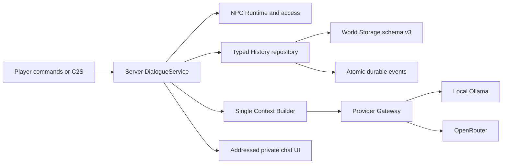

P5.1 Verified 2026-11-06: [отчёт009](reports/2026-11-06-009-lorebook-crud.md), [ADR0025](decisions/ADR-0025-lorebook-storage-and-sources.md), [команды Lorebook](MEMORY.md). Schema4/CRUD/scopes/activation/pack-local overrides,107tests PASS+3skipped, dedicated2clients PASS. Следующая P5.2, вся P5 ещё не завершена.

# Актуальная карта после P4 (2026-11-06)

P0–P4 Verified в границах [ROADMAP](ROADMAP.md), [итог008](reports/2026-11-06-008-phase4-acceptance.md). P5 не начиналась. Следующая таблица добавляет/уточняет фактический код; нижние срезы сохраняют историю и не отменяют текущий статус.

| Путь | Текущая ответственность |
|---|---|
| `src/main/java/dev/agnor/content/` | Strict PackLoader/PackJson, immutable ContentPack, PackResolver/PackGeneration, world PackStore/current/previous, bounded ContentService, sanitized PackResources, consent PackDownload/PackTransfer |
| `character/DefinitionRegistry`, `CharacterDefinition`, `NpcRuntime`, `NpcEntity` | Single generation registry, prompt, same-identity redefine/availability fallback/public digest binding |
| `storage/NpcRepository`, `dialogue/` | Stable assignment, прежние History/relationships, pack style в едином ContextBuilder, cancellation on content change; DB schema v3 |
| `network/Pack*` | Versioned bounded public catalog/pull sync, exact-digest persistent admin opt-in, commands/chat controls и owner checks |
| `src/client/java/dev/agnor/client/{ContentClient,ContentResources,PackClient}.java` | Local/received directories, contained in-memory resource provider, explicit fetch/cancel, resource reload/rollback и exact digest match |
| `src/client/java/dev/agnor/client/mixin/ContentProviderAccess.java` | Только client provider access; client mixin config в client resources |
| `motion/MotionService`, `MotionRig`, client presentation | Per-NPC pack rig, static/motion fallback, monotonic pose sequence/cache invalidation; прежний P3 dev property сохранён |
| `src/test/java/dev/agnor/content/` | 19 новых tests: loader8/activation6/transfer5; всего105/102PASS/3opt-in skipped |
| `src/p4Check/`, `scripts/{p4-check.gradle,prepare-p4-check.py}` | Opt-in activation/restart/two-client/integrated evidence; не normal JAR |
| `docs/CONTENT_PACKS.md` | Manifest v1, paths, команды и user/admin policy |
| `build/p4-check/` | Ignored synthetic worlds/DB, restricted copied local assets, permitted public fixture, logs/PNG и audits |

Не реализованы Lorebook/когнитивные agents/navigation/TTS/executable addons (P5+). UI пока clickable command/chat panel. [Ограничения внешних пакетов](CONTENT_PACKS.md), [границы visuals](assets/FIREFLY_VISUAL_LIMITS.md).

---

P4.2 Verified 2026-11-06: [отчёт006](reports/2026-11-06-006-pack-activation.md), [ADR-0023](decisions/ADR-0023-content-generations-and-presentation.md). Atomic Registry/last-known-good, same UUID/external Firefly, dedicated+restart+integrated PASS;97tests PASS/3skipped. Следующая P4.3, вся P4 ещё не завершена.

P4.1: `src/main/java/dev/agnor/content/` — immutable ContentPack, strict PackJson, bounded PackLoader и PackResolver; `src/test/java/dev/agnor/content/PackLoaderTest.java` — 8 contract scenarios. См. [формат](CONTENT_PACKS.md).

# Карта фактического проекта AGNOR

**P3 Verified,2026-11-06:** P3.1–P3.5 последовательно завершены в документированных границах. [Итоговая приёмка и бюджеты](reports/2026-11-06-004-phase3-acceptance.md), [pose sync/dialogue/compat](reports/2026-11-06-003-pose-sync-dialogue.md), [визуальные ограничения](assets/FIREFLY_VISUAL_LIMITS.md). Dedicated2clients и integrated, реальный dialogue/retry, reconnect/mismatch/stale, selected Sodium/Iris/Complementary PASS;83tests PASS/3opt-in skipped. Локальный dev rig adapter до P4; full cloth/MToon/voice/navigation не заявлены. Следующая фаза P4 не начата.

**P3.5,2026-11-06:** `network/PoseWire.java`/`PoseProtocol.java` — bounded S2C; `motion/MotionRig.java`/`MotionService.java`/`DialogueMotion.java` — local metadata, host producer и public dialogue cues; `motion/PoseBuffer.java`/`client/NpcMotionClient.java` — interpolation, identity/revision/sequence guard, lifecycle reset/fallback. `GemNpcRenderer` потребляет paired root/joints/morphs, не запускает gameplay physics. `src/p35Check/`, `scripts/p35-check.gradle`, `prepare-p35-check.ps1`, `prepare-p35-compat.ps1` — opt-in dedicated/integrated/multi/compat и async world GPU timers. [Отчёт003](reports/2026-11-06-003-pose-sync-dialogue.md), [итог004](reports/2026-11-06-004-phase3-acceptance.md). Build86tests:83PASS/3skipped; artifacts/модели/private metadata ignored. Ниже — исторические срезы.

**После P3.4 (2026-11-06):** `motion/ProceduralLocomotion.java`, `SecondaryPhysics.java` — stable-origin gait и bounded spring tips; +10targeted tests(29motion tests total). `src/p33Check/.../P34Scenes.java` — sequential stages e/f, shared dedicated/client harness; `scripts/p33-check.gradle` требует fresh host JSON и client PNG, поддерживает quoted motionView. [Отчёт002](reports/2026-11-06-002-locomotion-secondary.md), ADR-0020, [визуальные limits](assets/FIREFLY_VISUAL_LIMITS.md).67tests PASS+3skipped; следующая P3.5, игровой adapter пока static.

**Актуально после P3.3 (2026-11-06):** `src/main/java/dev/agnor/motion/` — CPU rig/clip/mixer/IK/semantic tasks/face; `src/test/.../motion/` —19targeted tests; `src/p33Check/`, `scripts/p33-check.gradle`, `prepare-p33-check.ps1`, `prepare-p33-face.ps1` — dedicated/client controlled scenes. `local-assets/firefly/`/`build/p33-check/` ignored:18morphed parts, packed Blender QA, snapshots/images. [Отчёт](reports/2026-11-06-001-pose-face-pipeline.md). P3.3 Verified, следующая P3.4. Основной игровой renderer всё ещё static P3.2, integration — P3.5.

**Последний срез P3.2:** `character/NpcEntity.java` — registered NPC type с прежним Storage UUID; `client/NpcPresentation.java`, `GemNpcRenderer.java` — optional client renderer/fallback. Gradle9.7.1, Loom1.16.3, API0.116.15. `scripts/prepare-renderer.ps1` — pinned build dependency, `inspect-models.py`/`partition-local-model.py` — local-only adaptation, `prepare-p32-check.ps1`/`p32-check.gradle`/`src/p32Check` — opt-in runtime fixture. [Отчёт014](reports/2026-11-05-014-npc-model-adapter.md). P3.2 Verified, P3.3 следующая; нижние срезы исторические.

Актуальный P3.1 proof: [отчёт 013](reports/2026-11-05-013-renderer-adapter-proof.md). `scripts/p3-toolchain.gradle`, `prepare-p3-toolchain.ps1`, `src/p3Check/client/`, `src/p3Check/host/`, `rig-probe.json` — isolated client/dedicated fixture. Gradle 9.7.1/Loom1.16.3/API0.116.15 проверены только здесь. GPU morph/pose/reload/reset и GPU-free host metadata proof PASS. Следующая задача P3.2; production код пока прежний.

Обновление P3.1: [отчёт 012](reports/2026-11-05-012-renderer-capability.md), ADR-0017. `src/p3Check/`, `scripts/p3-check.gradle`, `prepare-p3-check.ps1`, `create-p3-fixture.py` — opt-in rig/morph/clip experiment. `build/p3-research/` — ignored candidate/source snapshots/logs. Headless CPU PASS, candidate client remap FAIL; production renderer отсутствует. Следующий шаг — ограниченный adapter proof до P3.2. Нижеследующий срез P2 сохраняет описание production кода.

Срез 2026-11-05 после завершения P2. Ветка main, актуальный HEAD/status проверять Git. P1 baseline сохранён fcb46e5; P2.1 05a8011, P2.2 27e0bdd, P2.3 58e00e5; P2.4 — коммит итогового отчёта. Remote не изменялся. Источник criteria — ROADMAP, реализации/evidence — код и отчёты 006/008–011.

| Путь | Фактическое назначение |
|---|---|
| build.gradle, gradle.properties, wrapper | Java 21, Minecraft 1.21.1, Fabric Loader 0.16.10, API 0.102.1+1.21.1, Loom 1.7.4, Gradle 8.8; sqlite-jdbc 3.51.0.0 bundled |
| src/main/java/dev/agnor/Agnor.java | Server-save storage/config и session-owned NPC/Gateway/Dialogue lifecycle; reverse shutdown |
| storage/WorldStorage.java, WorldConfig.java | Одна world DB schema v3, scoped transaction, migration/pre-backup, same-version/world restore; atomic world properties |
| storage/NpcRepository.java, NpcSchema.java | Сохраняемые NPC/relationships, operation dedupe, revision и tombstone |
| storage/HistoryRepository.java, HistorySchema.java | Conversation/turn/messages/events; canonical counts, request claim/reconciliation, restart interruption, scoped N reads, protected replay range |
| character/ | Built-in definition registry, runtime snapshots и bounded storage IO; временный armor stand с тем же UUID, без второго NBT writer |
| provider/ | Нейтральный Main Dialogue request/result, server preset, bounded cancellable HTTP, Ollama и OpenRouter adapters, env/named external file secret resolver; streaming не реализован |
| dialogue/ | Trusted ConversationScope, typed HistoryMessage, единый budgeted ContextBuilder и server DialogueService |
| network/Npc*.java | P1 commands/access/private snapshots, connection selection |
| network/Dialogue*.java | P2 say/retry/history/cancel, versioned bounded private C2S/S2C, безопасные terminal errors |
| network/ProbeProtocol.java | Read-only addressed probe, rate/disconnect cleanup; используется также для tick proof |
| src/client/java/dev/agnor/client/ | Каталог/JOIN probe/NPC feedback и private dialogue chat presentation с MessageId dedupe |
| src/main/java/dev/agnor/DataRoots.java | Packs/presets/cache/log directories; приватная DB находится только в server-save/agnor/state.db |
| src/test/ | 38 ordinary tests; providerLive/historyLive/cloudLive только opt-in, обычная suite их пропускает |
| src/probe/, scripts/phase0.gradle | Opt-in bootstrap/probe harness, не normal JAR |
| src/lifecycleCheck/, scripts/lifecycle-check.gradle | Opt-in NPC lifecycle evidence |
| src/p1Check/, scripts/p1-check.gradle, run-p1-check.ps1 | Существующая P1 двухклиентская/двухмировая приёмка и integrated restart |
| src/p2Check/, scripts/p2-check.gradle, run-p2-check.ps1 | Реальные P2 commands/packets/UI, local/cloud, restart/privacy/retry; controlled mock только для отказов |
| scripts/dev.ps1 | Wrapper helper с найденным JDK 21; другие tasks через gradlew.bat |
| build/p2-evidence/, build/p2-check/ | Ignored synthetic runtime/provider evidence, logs/markers/DB и архивы неуспешных стендовых попыток |
| docs/, skills/agnor-development/SKILL.md | Индекс/план/ADR/отчёты/проектный workflow |

## Фактический статус

P0/P1 сохранены; [006](reports/2026-11-05-006-phase1-management.md) описывает исходную P1 приёмку. P2 Verified в границах Roadmap: [008](reports/2026-11-05-008-provider-gateway-verified.md) Gateway, [009](reports/2026-11-05-009-history-context.md) History/context, [010](reports/2026-11-05-010-dialogue-path.md) private gameplay и события, [011](reports/2026-11-05-011-phase2-complete.md) local/cloud/failure integration. ADR-0013–0016 фиксируют контракт.

Подтверждены реальные local Ollama и OpenRouter, два игрока и отдельные save roots, dedicated/integrated restart, request/MessageId dedupe, timeout (server clock +40 ticks), cancel/disconnect/stale, atomic message/event counts. Финальные DB integrity/FK проверки успешны, source/evidence audit не нашёл выбранный credential. Стендовые ошибки и D2 wrapper exit1 не скрыты; последующие D3/I4 orchestration exits=0.

**Не реализовано:** 3D renderer/rig/motion/IK/physics P3, внешний pack loader P4, Lorebook и остальные пять memory stores, gnomes/schedulers/navigation/actions/TTS/addons. Единственный writer памяти сейчас — History; event log не является Action Memory, future sources явно NOT_YET_ENABLED. UI — команды/чат, без графического редактора. Streaming не заявлен. Нет public release/online auth/soak/full compatibility claims.

## Рабочая область

Repo: C:/Users/User/Documents/Codex/AGNOR/modeagnor. Parent AGNOR — контейнер материалов, не Git root; work/tunnel-plugin — отдельный проект, его AGENTS сюда не относятся. Применимых AGENTS.md в repo/предках не найдено. Пользовательские worlds/keys не переносятся в Git. Launcher и Ollama runtime восстановлены отдельно; текущий текстовый тег — ternary-bonsai-text-20k:latest. P3.1 исследована; следующий bounded adapter proof — ADR-0017, P3.2 не начата.
