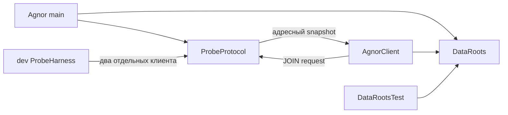

# Карта фактического проекта

Срез 2026-11-05. Репозиторий: `C:/Users/User/Documents/Codex/AGNOR/modeagnor`, branch `main`, HEAD `5d06367178325fcb6b41c1075af1ae0c5cc91613`. Код/Wrapper находятся в незакоммиченном рабочем дереве; состояние remote HEAD не описывает локальную реализацию. Git-история пока преимущественно документационная. Перед новой работой повторить `git status`, не перезаписывать dirty files.

| Путь | Фактическое назначение и состояние |
|---|---|
| `build.gradle`, `settings.gradle`, `gradle.properties` | Сборочный каркас Fabric Loom 1.7.4, Minecraft 1.21.1, Yarn 1.21.1+build.3, Loader 0.16.10, API 0.102.1+1.21.1, Java 21 |
| `gradlew`, `gradlew.bat`, `gradle/wrapper/` | Gradle Wrapper 8.8; отдельная глобальная установка не нужна |
| `src/main/java/dev/agnor/Agnor.java` | Регистрация probe, SERVER_STARTING → DataRoots; NPC runtime отсутствует |
| `src/main/java/dev/agnor/DataRoots.java` | Создание packs/presets/cache/logs/server под gameDir/mods/agnor; только каталоги, не stores/pack loader |
| `src/main/java/dev/agnor/network/ProbeProtocol.java` | Versioned read-only probe, адресный ответ, rate limit, disconnect/stop cleanup; не NPC protocol и не permissions |
| `src/main/resources/fabric.mod.json` | Main/client entrypoints и зависимости; declared диапазоны шире tested matrix |
| `src/client/java/dev/agnor/client/AgnorClient.java` | Локальный каталог, JOIN probe и log response; нет пользовательского диалогового UI/renderer |
| `src/test/java/dev/agnor/DataRootsTest.java` | Три теста: custom gameDir/repeat+marker, изоляция каталогов, file collision. Не проверяют world-scoped persistence или ACL |
| `src/probe/java/dev/agnor/probe/ProbeHarness.java`, `src/probe/resources/fabric.mod.json` | Отдельный dev-only мод: два клиента, ожидаемые ответы, exit; не входит в normal JAR |
| `scripts/dev.ps1` | Wrapper launcher с существующим JDK 21 и разрешёнными dev tasks |
| `scripts/storage_spike.py` | Изолированный P1.1 SQLite/JSON fixture; не source set и не Storage Facade; evidence в `build/p1.1-evidence/` |
| `scripts/phase0.gradle` | Условный `-Pphase0` source set/run configs; loopback-only dedicated harness |
| `.gitignore` | Исключает build/run/local-assets/IDE/Gradle cache |
| `build/phase0-evidence/` | Локальные runtime логи, в том числе первоначальный native crash и успешные повторы; ignored, не часть Git |
| `build/test-results/test/` | Существующий XML трёх DataRoots tests; evidence прошлого запуска, не новый аудит-тест |
| `build/audit-2026-11-05/` | Локальная резервная копия до аудита, хеши кода и результаты документальных проверок; ignored |
| `docs/` | [Индекс источников истины](INDEX.md), спецификация, план, ADR и отчёты |
| `skills/agnor-development/SKILL.md` | Проектные инструкции; пути в docs идут через `../../docs/` |

## Реализовано, частично и отсутствует

**Проверено в пределах P0:** сборка, разделение сред, bootstrap обоих серверных режимов, создание каталогов, probe двух dev UUID, restart marker. **Частично подготовлено:** filesystem layout и network DTO можно расширять; они не означают готовность конфигураций, persistent scope, permissions или продуктового handshake. **Заглушки:** продуктовых NPC/AI stubs нет; пустой `server/` legacy-каталог — не backend. Placeholder для P1 только запланирован.

**Отсутствует:** Character Definition Registry/entity/lifecycle, Storage Facade/БД/миграции, settings UI/permissions, provider/dialogue/history, renderer/модели/rig/IK/FK/physics, Content Pack loader/sync, шесть memory stores, пять gnomes, оба scheduler, observer/actions/navigation, TTS, addons и CI workflows. Все одноимённые компоненты ARCHITECTURE/Blueprint пока проектные.

## Реальные связи

Ресурсные каталоги могут быть общими для gameDir, но приватные saves должны быть world-scoped в P1.1. Ни один текущий файл не сохраняет NPC state. Удалять legacy каталог в рамках аудита не требуется.

## Рабочая область вне репозитория

`C:/Users/User/Documents/Codex/AGNOR/` — контейнер проекта, не Git root. `incoming/`, `assets/models/`, `assets/textures/`, `builds/`, `reports/` — локальные материалы. `work/tunnel-plugin/` — другой проект, его AGENTS не относятся к ModeAgnor. Корневой [указатель](../../УКАЗАТЕЛЬ.md) и [environment](../../environment.md) описывают workspace. Применимых AGENTS.md в repo/его предках на момент аудита не найдено.

P1.1 завершена: [ADR-0010](decisions/ADR-0010-world-scoped-storage.md), [контрольная build и fixture](reports/2026-11-05-002-storage-contract.md). Следующая работа — [ROADMAP P1.2](ROADMAP.md); production storage остаётся отсутствующим. Исторические отчёты о старой фазе 0 не задают порядок.
