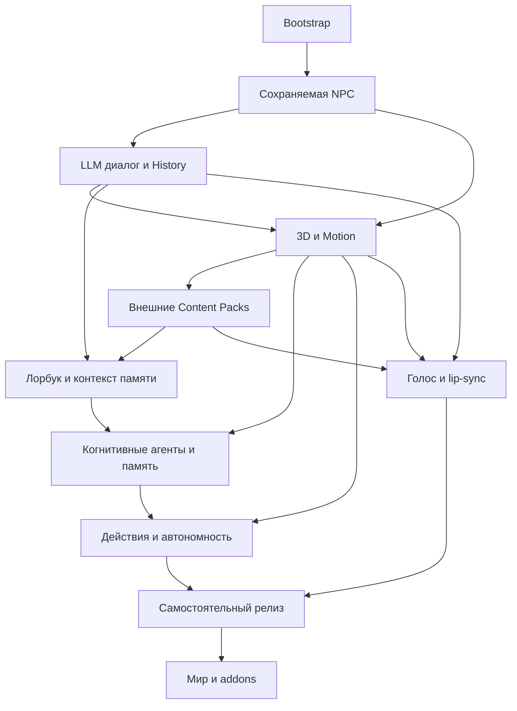

# План разработки ModeAgnor

Редакция 2026-11-05. Идентификаторы **P0–P10** отличают этот план от исторических фаз 0–11. Только этот документ задаёт порядок и критерии готовности; Blueprint задаёт устройство. Фактический прогресс — в [журнале](DEVELOPMENT_LOG.md), исходники — в [карте проекта](PROJECT_MAP.md). Основания изменений: [аудит](reports/2026-11-05-001-architecture-replan.md), [матрица переноса](PLAN_MIGRATION.md), [ADR-0009](decisions/ADR-0009-dependency-driven-plan.md).

Конечная цель неизменна: полноценные высококачественные 3D-аниме-NPC с процедурным телом/лицом/глазами, физическим взаимодействием, самостоятельными LLM-решениями, пятью специализированными агентами, шестью видами памяти, голосом, сохранением и мультиплеером. Placeholder и scripted driver — промежуточные средства проверки, не релизная замена этих функций.

## Правила выполнения и проверок

- **А — текущая реализация:** после изменения проверять затронутый контракт и пользовательский путь. Проверки уже подтверждённого неизменённого bootstrap не повторять без причины.
- **Б — архитектурный риск:** один вопрос, заранее заданные критерии выбора и остановки, минимальный fixture. Если evidence достаточно, прототип не нужен. Не реализовывать будущую подсистему под названием spike.
- **В — будущая интеграция:** выполняется только после появления всех участников. В критерии текущей фазы входят лишь перечисленные ниже интеграции; ещё не созданные функции их не блокируют.
- Задачи внутри фазы принимаются отдельно по своему результату. Полная фаза закрывается после её интеграционного сценария. Runtime feedback cycle не обязывает писать всех участников одновременно.
- Перед задачей уточнять только её данные, lifecycle, thread ownership, ошибки и проверки. Не закрывать все Open-вопросы Blueprint заранее. Не создавать таблицы, workers, очереди или публичные API без текущего потребителя.
- Сеть проверяется двумя игроками при изменении адресности/общего состояния/прав; restart — при изменении persistence; HTTP failures — при изменении provider. Они не являются обязательным набором для любого изменения текста, UI или чистой математики.
- Значения CPU/GPU/network/LLM budgets фиксируются в отчёте до приёмочного замера на указанном железе и сцене. Нельзя объявлять performance PASS без чисел; измерение не должно снижать целевое качество до vanilla NPC.

## Зависимости и рекомендуемый порядок

Рекомендуемый последовательный маршрут: P0 → P1 → P2 → P3 → P4 → P5 → P6 → P7 → P8 → P9 → P10. Не все соседние этапы являются жёсткими зависимостями: например, голос не требует автономной навигации. Рёбра показывают входы полной приёмки, а не запрет независимого contract test. Подробный граф подсистем и минимальные совместные срезы — в разделе 0 Blueprint.

## P0. Достоверный bootstrap

**Цель:** доказать, что на выбранной платформе можно продолжать функциональную разработку. **Предусловия:** локальный репозиторий, JDK 21 и разрешённые локальные игровые запуски. **Подсистемы:** lifecycle, source sets, общий каталог, диагностический probe.

| Задача | Зависит от | Результат и проверка |
|---|---|---|
| P0.1 Зафиксировать платформу и split main/client, Wrapper | — | А: сборка JAR; client classes не загружаются dedicated server |
| P0.2 Проверить lifecycle и каталог ресурсов | P0.1 | А: integrated/dedicated startup, нестандартный gameDir, повторное создание, конфликт с файлом |
| P0.3 Проверить адресный probe и повторный запуск | P0.2 | А: два dev UUID, ошибки version/sequence, burst и replay, marker после restart |

**Контракт:** Probe v1 — read-only диагностика, не протокол NPC или permissions. Каталог ресурсов не является world storage.
**Минимальный результат и выход:** воспроизводимая сборка и существующие проверки P0.1–P0.3 подтверждены отчётом 2026-11-04-004 и сохранёнными логами; три unit-теста проходят. По новой границе P0 выполнена. Это переоценка объёма по запросу пользователя, а не утверждение о выполнении прежнего широкого gate.
**Отложено:** storage — P1.1; renderer/morph/headless pose — P3.1; IK/gait/physics/pose sync — P3; provider — P2; полная матрица модов — P9. Готовые модели и Blender для P0 не нужны.
**Риски:** единичный native GLFW crash не объяснён; ACL denial, raw malformed packets и точная граница rate limit не подтверждены. Это не доказанная поломка bootstrap: проверять по триггеру изменения соответствующего кода, до релиза — P9.1. [Протокол и ограничения evidence](PHASE_0_SPIKES.md).

## P1. Первая сохраняемая NPC и безопасное управление

**Цель:** игрок создаёт NPC, взаимодействует с её базовым состоянием и находит её после перезапуска. **Предусловия:** P0. **Подсистемы:** Character Runtime/Definition Registry, Storage Facade, permissions, config, UI, network.

| Задача | Зависит от | Результат и проверка |
|---|---|---|
| P1.1 Выбрать backend и world-scoped storage contract | P0 | Б: сравнить SQLite/JSON на одном NPC + двух relationship records; atomic update/rollback, restart, migration и два мира; зафиксировать выбор ADR |
| P1.2 Реализовать минимальный Storage Facade и настройки | P1.1 | А: schema version, scoped transaction, backup/restore одной версии, ошибка записи без потери предыдущего состояния; save/reload config |
| P1.3 Создать Definition Registry, entity UUID и lifecycle | P1.2 | А: встроенное dev definition; create/load/unload/delete с tombstone/idempotency; сохранение позиции/runtime и отдельных отношений |
| P1.4 Подключить управление, права и snapshots | P1.3 | А: spawn/select/delete через минимальный UI/команду, owner/admin checks, protocol version/size limits, безопасные логи без секретов, два игрока и два мира |

**Контракты:** WorldId/NpcId/PlayerUUID, versioned CharacterDefinition/RuntimeSnapshot, operation ID, permission context, scoped transaction; память пока только ownership IDs. World storage определяется из server save, а не общего gameDir; точный layout закрепить в P1.1.
**Результат/выход:** одна NPC с явно временным placeholder появляется, сохраняется и удаляется без дубликатов; два игрока имеют раздельные отношения, чужой мир/неавторизованный запрос не изменяет состояние. Проверить integrated и dedicated restart; отсутствие модели не блокирует server activation.
**Статус 2026-11-05: P1 Verified в перечисленных границах.** P1.1–P1.4 реализованы; [отчёт 006](reports/2026-11-05-006-phase1-management.md), [ADR-0012](decisions/ADR-0012-npc-management-protocol.md). Проверены команды/owner/admin checks/адресные bounded snapshots, два игрока и два save roots, dedicated/integrated restart, отдельные relationships, tombstone/idempotency. 22 unit tests и сборка PASS. Предыдущие storage/lifecycle evidence — [отчёт 005](reports/2026-11-05-005-npc-lifecycle.md). Физический disk-full/ACL, online authentication и installed release-JAR/полная compatibility matrix не объявляются проверенными. P2 впоследствии принята (отчёт 011); следующая незавершённая фаза — P3.

**Отложено:** шесть memory stores, AI queues/outbox, полноценный редактор, renderer. **Риски:** unload vs delete, двойная запись entity и storage, исключение client classes. `DataRoots.serverData` исключён из приватного storage контрактом ADR-0010; применение server-save пути обязательно до первой приватной записи.

Историческое начало P1.3 и исправление connection settings — [отчёт 004](reports/2026-11-05-004-storage-followup-definition-registry.md); последующее завершение — отчёт 005.

## P2. Реальный LLM-диалог с сохраняемой историей

**Цель:** NPC отвечает игроку через локальный или облачный LLM без блокировки мира. **Предусловия:** P1. **Подсистемы:** Provider Gateway, presets, Conversation History, Context Builder, диалоговый UI, durable event log.

| Задача | Зависит от | Результат и проверка |
|---|---|---|
| P2.1 Gateway и Main Dialogue preset | P1.4 | А: endpoint/host secrets, capabilities, bounded async IO, timeout/cancel, ограниченный retry; один реальный endpoint сначала |
| P2.2 History + единый Context Builder | P1.2 | А: accepted inbound и final reply, sequence/scope, recent N default 10, roles/system policy, runtime/relationship snapshot, бюджет контекста |
| P2.3 Диалоговый вертикальный путь и event log | P2.1, P2.2 | А: UI → validated request → context → provider → committed reply → private UI; History+event atomic, restart и request dedupe |
| P2.4 Локальный/облачный режим и отказы | P2.3 | А: проверить оба режима конфигурации, streaming если заявлен capability, disconnect/cancel/stale reply, secret redaction; mock для отказов и реальный happy path |

**Контракты:** ProviderRequest/Result, ConversationId/MessageId/sequence, ContextSource status, DialoguePresentationIntent. Только Main Dialogue destination активен. Outbox хранит события и ссылки на защищённые сообщения; per-consumer cursors/leases создаются при включении consumer в P6. Pending источники нельзя обрезать обычным recent-N лимитом.
**Результат/выход:** два игрока независимо говорят с NPC, история восстанавливается; запрос/ответ не дублируется при retry; отказ API не стопорит tick и не раскрывает чужой диалог. Для каждого режима нужен реальный проверенный endpoint; отсутствие credentials отмечается как конкретная незавершённая P2.4, а не имитация PASS.
**Отложено:** gaze/жесты до P3, gnome presets до P6, Bot до P7, TTS до P8. Семантический speaking state можно показать текстом. **Риски:** неполный streaming, цена/контекст, crash между commit и отправкой UI, retention до активации consumers. Единица счёта: accepted inbound = 1, final assistant = 1; partial/system/retry = 0.

**Статус 2026-11-05: P2 Verified в перечисленных границах.** P2.1–P2.4 реализованы последовательно; [итог 011](reports/2026-11-05-011-phase2-complete.md), срезы [008](reports/2026-11-05-008-provider-gateway-verified.md)/[009](reports/2026-11-05-009-history-context.md)/[010](reports/2026-11-05-010-dialogue-path.md), ADR-0013–0016. Реальные local Ollama и cloud OpenRouter, private gameplay UI, два игрока/restart/retry, canonical History+events, timeout без блокировки тика, cancel/disconnect/stale подтверждены. 38 unit tests/build PASS; streaming не заявлен. Ошибки dev orchestration и ограничения сохранены в отчёте. Остановлено перед P3.1; P3 не начиналась.

## P3. Выразительная 3D-NPC и управляемое тело

**P3 Verified,2026-11-06:** P3.1–P3.5 последовательно завершены в документированных границах. [Итоговая приёмка и бюджеты](reports/2026-11-06-004-phase3-acceptance.md), [pose sync/dialogue/compat](reports/2026-11-06-003-pose-sync-dialogue.md), [визуальные ограничения](assets/FIREFLY_VISUAL_LIMITS.md). Dedicated2clients и integrated, реальный dialogue/retry, reconnect/mismatch/stale, selected Sodium/Iris/Complementary PASS;83tests PASS/3opt-in skipped. Локальный dev rig adapter до P4; full cloth/MToon/voice/navigation не заявлены. P4 впоследствии завершена; актуальная приёмка — в разделе P4.

[Поиск Miyabi](assets/MIYABI_MODEL_SEARCH.md) выполнен; новая модель не активирована. Пользовательская коллекция: `C:/Users/User/Documents/Codex/AGNOR/assets/models/разное`. История P3.1 comparison/adapter — отчёты012/013, P3.2 —014, P3.3 —2026-11-06-001, P3.4 —002, P3.5 —003/004.

**Цель:** заменить placeholder полноценным anime mesh и связать тело/лицо с уже работающим диалогом. **Предусловия:** P1; P2 нужен для конечной диалоговой приёмки, не для P3.1. **Подсистемы:** importer/renderer adapter, rig, Motion Engine, Face Controller, host physics, Pose Publisher.

| Задача | Зависит от | Результат и проверка |
|---|---|---|
| P3.1 Закрыть риск renderer/формата | P1 | Б: сопоставить GemRender/BlendLib/custom по текущим исходникам и лицензиям; один малый rig+morph fixture, headless pose read/evaluate, client palette/morph override и exact Fabric matrix; остановиться после ответа по API, не писать gait/physics |
| P3.2 Подключить готовую модель к существующей NPC | P3.1 | А: renderer adapter, import/rig mapping/materials/textures/scale; одна rigged anime-модель и static capability fallback, минимальная Blender адаптация при необходимости; повторная загрузка и отсутствие GPU dependencies на сервере |
| P3.3 Собрать animation/pose/face pipeline | P3.2 | А: clip crossfade/masks/additive, FK/IK и joint limits, foot/look/reach/turn, глаза/мимика, whole-body arbitration; сначала простой Two-Bone, FABRIK/CCD лишь для нерешённых цепей |
| P3.4 Процедурная локомоция и secondary physics | P3.3 | А: scripted root velocity, start/stop/turn/run, pelvis/weight/arms; host spring chains, ограниченные collision proxies и clipping scenes |
| P3.5 Синхронизация и реальный диалоговый adapter | P3.4, P2.3 | А: pose sequence/rig hash/reconnect, два клиента; listening/thinking/speaking, взгляд на собеседника, валидированные жесты/expressions, neutral fallback; замеры CPU/GPU/bytes на одной и нескольких NPC |

Внутри P3.3 завершать и проверять последовательно: (а) clips/crossfade/masks/additive на фиксированном rig; (б) FK/Two-Bone IK/joint limits на одной цепи; (в) whole-body arbitration и foot/look/reach на тестовых контактах; (г) eye/face channels и независимые expressions. Каждая часть имеет отдельный управляемый сценарий и не ждёт gait/physics P3.4. P3.4 сначала проверяет походку, затем вторичную физику на той же модели. Это подзадачи одной продуктовой фазы, не ещё один общий предварительный gate.

**Контракты:** renderer-independent RigDescriptor, MotionTask (priority/expiry/cancel), host PoseSnapshot (sequence/tick/rig revision), expression channels; semantic intents вместо LLM bone arrays. Сервер вычисляет pose/IK/secondary state, клиент интерполирует и выполняет skinning; render backend не владеет gameplay identity.
**Результат/выход:** тестовая anime-NPC имеет корректные материалы, скелет, смешивание движений, управляемое лицо/глаза и вторичную физику; отвечает на реальный диалог визуально; два клиента видят согласованное состояние. Записать визуальные сцены, дефекты и измеренные бюджеты; проверить baseline и выбранные Sodium/Iris версии. Shader fallback не называть полной совместимостью.
**Отложено:** выбор пути/реальное следование — P7; Thinker affect — P6; audio lip-sync — P8; широкая compatibility matrix — P9. **Риски:** runtime morphs и dedicated classloading библиотек, joint/morph binding стабильность, сетевой объём, прозрачность/волосы/cloth clipping. Если ни один backend не проходит P3.1, зафиксировать ограниченный план adapter/custom proof; не заменять конечную цель vanilla renderer и не объявлять собственный renderer доказанным заранее.

## P4. Внешние персонажи и Content Packs

**Цель:** сменить/добавить персонажа без пересборки мода. **Предусловия:** P3, P2 для действующих prompts. **Подсистемы:** pack loader, Registry, model resources, настройки и sync.

| Задача | Зависит от | Результат и проверка |
|---|---|---|
| P4.1 Manifest и безопасный loader | P3.2 | А: schema/version/hash, path traversal/limits/signatures, provenance/rights, dependencies/cycles/override priority |
| P4.2 Активация через существующий Registry | P4.1 | А: stage/enable/disable/reload/rollback, capability report, внешний definition с тем же NPC identity; fallback недостающих channels |
| P4.3 UI и разрешённая синхронизация | P4.2 | А: local user dirs, выбор/настройки, version mismatch/reconnect; policy отказа/получения разрешённых ассетов с лимитами; запрещённые ассеты не передаются |

**Статус 2026-11-06: P4 Verified в перечисленных границах.** P4.1–P4.3 выполнены и проверены последовательно: [005 loader](reports/2026-11-06-005-pack-ingestion.md), [006 activation](reports/2026-11-06-006-pack-activation.md), [007 UI/sync](reports/2026-11-06-007-pack-controls-sync.md), [008 итог](reports/2026-11-06-008-phase4-acceptance.md), ADR0022–0024. Внешний pack меняет модель/персональность той же NPC без JAR rebuild; corrupt reload не заменяет last-known-good, dedicated restart и integrated PASS. Два клиента: exact-digest mismatch/reconnect/local recovery, A consented public63040bytes/B0, Firefly0. Clickable command/chat UI, bounded≤16MiB transfer/explicit pinned admin opt-in.102tests PASS/3opt-in skipped/build PASS. Ограничения GLB/PNG adapter и private cache maintenance описаны в008; универсальный importer/full editor/релизная матрица не заявлены. P5 не начиналась.

**Контракты:** ContentPackSchema отдельно от executable Addon API; DefinitionSource, asset hash/rig revision, capability states. Prompt/voice/behavior данные пассивны до consumer; уже готовый Dialogue может использовать prompt сразу.
**Результат/выход:** внешний пакет меняет отображение и настройки персонажа без JAR rebuild; повреждённый пакет не уничтожает прошлую версию; multiplayer policy воспроизводима. **Отложено:** executable addons P10, voice consumer P8. **Риски:** unsafe files, ресурсные утечки reload, несовместимый rig, права на передачу. Временные restricted ассеты только локально и в реестре; никогда в публичных артефактах.

## P5. Управляемый контекст памяти

**Цель:** пользовательские знания реально влияют на диалог без полного когнитивного комплекса. **Предусловия:** P2, P4 для пользовательских pack-источников. **Подсистемы:** Lorebook, History UI, Context Source Registry, persistence.

| Задача | Зависит от | Результат и проверка |
|---|---|---|
| P5.1 Lorebook и интерфейс записей | P2.2, P4.2 | А: CRUD, Always/exact/keyword, роли, scope, priorities и pack/local overrides |
| P5.2 Включение в общий Context Builder | P5.1 | А: реальные диалоги с/без matching knowledge, source IDs, budget/truncation, NOT_YET_ENABLED для semantic search |
| P5.3 Управление и защита данных | P5.2 | А: History просмотра/настройки N, backup/restore/migration/retention текущих stores, два игрока; не стирать необработанный outbox source |

**Контракты:** ContextSourceRegistry с NOT_YET_ENABLED/AVAILABLE_EMPTY/AVAILABLE_WITH_DATA/TEMPORARILY_UNAVAILABLE/FORBIDDEN, profile allowlist/scope/freshness/budget; один engine. **Результат/выход:** подходящая запись лорбука попадает в контекст и влияет на ответ с трассируемым source ID; чужая/неподходящая не попадает. Сохраняемая история и знания восстанавливаются.
**Отложено:** Diary/Thoughts/ActionMemory/Summary создаются с реальными writers в P6; semantic embeddings P6.5. **Риски:** prompt injection не должен менять server permissions, смешение scope, конфликт лимита истории и replay. Шесть финальных видов памяти сохранены, но пустые API без writer не создаются ради номера фазы.

## P6. Динамическая память, мысли и эмоции

**Цель:** NPC осмысливает наблюдения, запоминает опыт и выражает состояние. **Предусловия:** P5, P3 для affect presentation. **Подсистемы:** четыре cognitive gnomes, scheduler, Event Feed, все шесть memory stores, embedding, context, affect.

| Задача | Зависит от | Результат и проверка |
|---|---|---|
| P6.1 Event Feed и Action Memory | P1.3, P5.3 | А: baseline при включении, типизированные события мира, dedupe/coalesce; сообщения не копируются в Action Memory |
| P6.2 Scheduler + Thinker → Thoughts | P6.1, P2.1 | А: bounded jobs и per-consumer replay/cursor с atomic enqueue ack, независимый preset, context profile, periodic/turn/event triggers, stale/expiry/cancel; Thoughts и pending proposal атомарны; подключить affect mapper к P3 |
| P6.3 Memorizer → Judge → Diary | P6.2 | А: History+Thoughts only → candidate → Judge → provenance/versioned Diary; Thinker читает реально созданную запись; per-consumer replay/lease и atomic enqueue ack |
| P6.4 Summarizer → Summary → Context | P6.3 | Б: выбрать day boundary/timezone до writer; А: каждые 10 committed records, input range/watermark, предыдущая Summary + events, restart без повторного count |
| P6.5 Embedding и эксплуатация полного цикла | P6.4 | А: semantic retrieval/duplicate candidates, versioned index/rebuild, keyword fallback, ручной dry-run/status/cancel/retry с правами; отказ одного provider и restart полного цикла |

**Контракты:** TaskId + consumer cursor/lease; Memorizer allowlist History/Thoughts; Judge sole automatic Diary writer; Thinker structured state (не скрытая chain-of-thought); GoalProposalInbox ID/scope/evidence/expiry/PENDING, пока без исполнения. Embedding — ускоритель retrieval, не судья истинности. Контекст источника до включения явно неполный, после включения может быть пустым.
**Результат/выход:** событие мира → Action Memory → Thinker/Thoughts → Memorizer/Judge → Diary → следующий Thinker; Summary меняет контекст, emotion меняет лицо/позу. Проверить scope, replay, stale result, bounded queues, privacy и failure isolation. P6.1–P6.4 принимаются как законченные ограниченные срезы; финальная приёмка P6 требует весь цикл.
**Отложено:** предложения не двигают NPC до P7; Bot inference отсутствует. **Риски:** feedback storms, конфликт убеждения и факта, цена inference, backlog до активации, TTL целей. Изменение Thought само по себе не вызывает бесконечную цепь пересчётов: version/no-op/coalescing и budget обязательны.

## P7. Самостоятельные действия в мире

**Цель:** мысли NPC приводят к безопасным реальным действиям и новым наблюдениям. **Предусловия:** P6, P3. **Подсистемы:** Goal Scheduler, Bot, Action Runtime, Navigation, Observer, Motion bridge.

| Задача | Зависит от | Результат и проверка |
|---|---|---|
| P7.1 Минимальное действие от запроса до результата | P1.4, P6.1 | А: typed plan/action registry, whitelist/schema/rights/range/cooldown, server-thread executor, idempotency, cancellation; ручная цель служит настоящим входом, deterministic plan — тестом validator |
| P7.2 Navigation и Motion bridge | P7.1, P3.5 | А: walk_to/follow, moving target, repath/stuck/unloaded chunks, stop/arrival, реальная velocity→gait; observable outcomes |
| P7.3 Goal Inbox → Scheduler → Bot | P7.2, P6.2 | А: atomic claim, expired/rejected goal, priority/preemption/dependencies, Bot preset и async typed planning; цель Thinker реально исполняется |
| P7.4 Замкнуть автономный цикл | P7.3, P6.5 | А: полный Observer/visibility/relevance, outcomes→Action Memory→Thinker, uncertain-effect reconciliation, anti-loop, два клиента и restart |

**Контракты:** Gnome Scheduler управляет inference jobs, Goal Scheduler — игровыми целями; ActionResult фиксирует исход, а не обещание LLM. Snapshot свежести валидируется повторно перед world effect. Root/collision authority у Minecraft server; cosmetic pose не телепортирует gameplay entity.
**Результат/выход:** NPC самостоятельно выбирает допустимую цель, подходит/следует/взаимодействует, реагирует на препятствие и меняет план по исходу; взгляд/жесты/эмоции/ходьба смешиваются. Проверить отказ, отмену, повтор, потерю соединения и двух игроков. **Отложено:** addons P10, голос P8. **Риски:** двойной side effect после crash, path cost, race между планом и миром; не обещать exactly-once внешнему миру без reconciliation. Автономность не считается готовой по одному mocked LLM-плану.

## P8. Голос и синхронизация лица

**Цель:** слышимая речь с корректным lip-sync. **Предусловия:** P2, P3, P4; P7 не требуется технически. **Подсистемы:** TTS, audio queue/cache/transport, Face Controller.

| Задача | Зависит от | Результат и проверка |
|---|---|---|
| P8.1 TTS preset, per-NPC voice и timeline | P2.3, P4.2 | А: bounded async synthesis, cache keys, capability visemes/timing, timeout и текстовый fallback |
| P8.2 Playback и face integration | P8.1, P3.3 | А: real audio clock→mouth, отдельные emotion channels, очередь/interrupt, join/seek/stale audio, два клиента и privacy policy |

**Контракты:** UtteranceId, audio format/hash, start clock, viseme timeline, cancellation; при отсутствии phoneme API допускается явно обозначенный анализ аудио, не случайное движение рта. **Результат/выход:** фраза слышна адресатам согласно scope, губы следуют playback, emotion сохраняется, отмена прекращает audio и mouth; текст работает при отказе TTS. **Отложено:** расширенные голосовые интеракции P10. **Риски:** drift, latency, повторный playback, bandwidth и секреты provider.

## P9. Законченный companion-релиз

**Цель:** устойчивый самостоятельный продукт без Create/авторского мира. **Предусловия:** P1–P8. **Подсистемы:** все, эксплуатация и extension boundary.

| Задача | Зависит от | Результат и проверка |
|---|---|---|
| P9.1 Регрессия, миграции и совместимость | P7.4, P8.2 | А/В: integrated/dedicated, online identity в разрешённом окружении, malformed packets, ACL failures, upgrade/rollback/restore, моды exact matrix; воспроизведение native crash при повторении |
| P9.2 Качество и длительная работа | P9.1 | В: несколько NPC/игроков, soak/restart, queue/cost/memory/bandwidth budgets; сцены anime quality, face/body/physics и autonomy; устранить критические дефекты |
| P9.3 Настройки, документация и API freeze | P9.2 | А: performance/API-cost controls, полный пользовательский сценарий установки/пакетов/персонажей/providers, stable versioned optional Addon API на проверенных Action/Goal/Event contracts |

**Контракты:** release compatibility matrix, save migrations, public extension versions. **Результат/выход:** все исходные companion-возможности проходят воспроизводимые сценарии; ограничения и поддерживаемые версии опубликованы, public artifacts не содержат restricted assets/секретов. Локальный реестр временных моделей может оставаться до P10, но выпускать их нельзя уже здесь. **Отложено:** перенос мира/конкретные addons. **Риски:** масштаб, крайние сочетания материалов/модов, неопределённое «качество ZZZ» — оценивать по зафиксированным визуальным сценам и бюджетам, не заявлять эквивалентность по компиляции.

## P10. Авторский мир, addons и полная версия

**Цель:** перенести мир Агнор и расширить готовое ядро. **Предусловия:** P9. **Подсистемы:** migration tools/workflow, content, optional addons.

| Задача | Зависит от | Результат и проверка |
|---|---|---|
| P10.1 Перенос мира и персонажей | P9.3 | А: inventory/mapping, sandbox conversion, checkpoints/rollback, реальные NPC/пакеты, сценарии локаций |
| P10.2 Addons и расширенные интеракции | P9.3 | Б: проверить доступную Fabric/Create matrix до adapter; А: addon failure isolation/versioning, дополнительные voice/world interactions |
| P10.3 Финальный выпуск | P10.1, P10.2 | В: полный сценарий мира, замена/удаление всех temporary assets, аудит дистрибутива и сохранений |

**Контракты:** стабильный Addon API, migration mappings/version/checkpoint, реестр происхождения. **Результат/выход:** мир перенесён, запрещённых временных моделей нет, optional integration не становится зависимостью ядра. При недоступной совместимой версии Create — документированное optional ограничение, не смена платформы без отдельного решения. **Отложено:** только расширения сверх согласованной цели. **Риски:** объём авторского контента, права и доступность сторонних модов.
